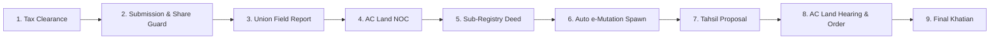
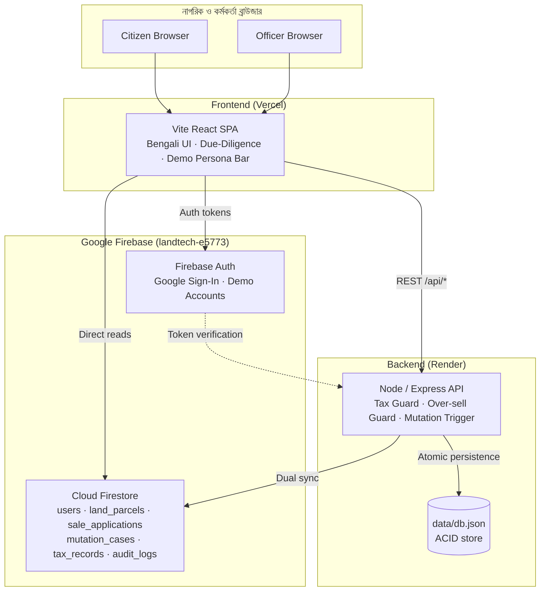

<div align="center">

# 🏛️ VumiSeba (ভূমিসেবা)

**Bangladesh Citizen Land Services · Pre-Purchase Due Diligence · Smart Registry · Automated e-Mutation**

*বাংলাদেশ নাগরিক ভূমি সেবা, স্বত্ব যাচাই, স্মার্ট রেজিস্ট্রি ও স্বয়ংক্রিয় ই-নামজারি প্ল্যাটফর্ম*


[Quick Start](#-quick-start) · [Workflow](#-the-9-stage-lifecycle) · [Real vs Simulated](#-real-vs-simulated) · [Roles](#-roles--office-panels) · [API](#-api-reference) · [Deploy](#-deployment)

</div>

---

## 📑 Table of Contents

1. [The Problem](#-the-problem)
2. [The Solution](#-the-solution)
3. [Quick Start](#-quick-start)
4. [The 9-Stage Lifecycle](#-the-9-stage-lifecycle)
5. [Real vs Simulated](#-real-vs-simulated)
6. [Features](#-features)
7. [Roles & Office Panels](#-roles--office-panels)
8. [Demo Accounts & Scenarios](#-demo-accounts--scenarios)
9. [Tech Stack](#-tech-stack)
10. [Architecture](#-architecture)
11. [Repository Structure](#-repository-structure)
12. [Database Schema](#-database-schema)
13. [API Reference](#-api-reference)
14. [Configuration](#-configuration)
15. [Testing](#-testing)
16. [Deployment](#-deployment)
17. [Security & Privacy](#-security--privacy)
18. [Known Limitations](#-known-limitations)
19. [Roadmap & Contributing](#-roadmap--contributing)

---

## 🎯 The Problem

In Bangladesh, over 70% of ongoing civil court litigation originates from land disputes. Two systemic gaps drive this:

| Gap | Impact |
|---|---|
| **Pre-purchase information blackout** (বায়নার পূর্বে স্বত্ব অন্ধত্ব) | Buyers sign binding earnest-money agreements (*বায়না*) without knowing whether the seller owns the stated share, whether taxes are overdue, or whether an injunction or bank mortgage encumbers the plot. |
| **Registry–mutation chasm** (রেজিস্ট্রেশন ও নামজারির ফারাক) | After registering at the Sub-Registry Office (Ministry of Law), citizens must manually open a separate mutation case at the AC Land Office (Ministry of Land). Delays and middlemen let rogue sellers sell the same plot repeatedly (*ডাবল-সেল জালিয়াতি*). |

## 💡 The Solution

A unified LandTech platform built on problem-solving, architectural honesty, and verifiable correctness.

- **🔍 P5: Check Before You Buy** (কেনার আগে জমি যাচাই) — Transparent 7-factor due diligence with **Critical Factor Overrides**. Active injunctions, government khas land, and unrecorded seller shares cap the safety score so a risky parcel can never read "Low Risk".
- **⚡ P4: Smart Registry → Automated e-Mutation** (স্মার্ট রেজিস্ট্রি ও স্বয়ংক্রিয় ই-নামজারি) — Completing deed registration atomically spawns an e-Mutation case in the AC Land docket. No manual paperwork, delays cut from months to ~24 hours, and transferred shares are locked in real time.

---

## 🚀 Quick Start

**Prerequisites:** Node.js v20 LTS (v18.18+ works), npm v9+, Git v2.30+

```bash
# 1. Clone and install
git clone https://github.com/BornilMahmud/VumiSeba.git && cd VumiSeba && npm install

# 2. Seed the demo dataset (21 synthetic parcels across 12 districts)
npm run seed:demo

# 3. Start backend API (port 5050) + frontend SPA (port 3000)
npm run dev
```

Open **http://localhost:3000/** and click the floating **"৩-মিনিট ডেমো গল্প (3-Min Judge Demo Story)"** button for a guided walkthrough.

> Default settings work with zero configuration. To customize, run `cp .env.example .env` (see [Configuration](#-configuration)).

<details>
<summary><b>Optional: seed Cloud Firestore</b></summary>

```bash
npm run seed:firestore   # idempotent; demo accounts + parcel records
```
</details>

---

## 🔄 The 9-Stage Lifecycle



| # | Stage | What happens |
|---|---|---|
| 1 | **Tax Clearance & Dakhila** | Arrears block sale submission at the server level until cleared. |
| 2 | **Submission + Basis-Point Share Guard** | Proposed shares are locked with integer arithmetic (`10,000 BPS`) to prevent fractional drift and double-selling. |
| 3 | **Union Field Investigation** | Union officers file on-ground possession, boundary, and tenant-rights reports. |
| 4 | **AC Land Title NOC** | State is re-validated before AC Land approval to guarantee clean title. |
| 5 | **Sub-Registry Deed Registration** | Biometric sign-off commits the deed record. |
| 6 | **Auto e-Mutation Case** | Registry execution atomically initializes the mutation case. |
| 7 | **Tahsil Proposal** | Automated docket routing to the relevant field circle. |
| 8 | **Hearing & Order** | AC Land issues the formal mutation judgment. |
| 9 | **Final Khatian** | New digital Khatian with verifiable QR code; seller share is decremented. |

<details>
<summary><b>Full state machine</b></summary>

```
[Citizen: Submit Application]
        │
        ▼
[1 UNION_REVIEW_PENDING] ── ► RETURNED_FOR_CORRECTION (citizen resubmits)
        │                 └─► UNION_REJECTED
        ▼
[2 AC_LAND_REVIEW_PENDING] ─► RETURNED_FOR_CORRECTION
        │                  └─► AC_LAND_REJECTED
        ▼
[3 REGISTRATION_READY]        সাব-রেজিস্ট্রি অফিসে শিডিউলের জন্য প্রস্তুত
        ▼
[4 APPOINTMENT_SCHEDULED]     triggers in-app alerts
        ▼
[5 REGISTRATION_COMPLETED]    deed no. / volume recorded
        ▼  (auto-spawn linked e-Mutation case)
[6 MUTATION_PENDING]
        ▼
[7 HEARING_SCHEDULED] ─────── ► MUTATION_REJECTED
        ▼
[8 MUTATION_APPROVED]         new Khatian & shares updated
        ▼
[9 KHATIAN_DELIVERED]         holding updated
```
</details>

---

## ⚖️ Real vs Simulated

> Operational honesty over artificial claims. Full details: [`docs/LIMITATIONS.md`](docs/LIMITATIONS.md).

| Component | Status | Boundary |
|---|:---:|---|
| Risk Engine & Critical Overrides | ✅ Real | 7 factors; injunctions and khas land strictly override scores. |
| Share Math (BPS) | ✅ Real | Integer basis points, zero rounding drift across generations. |
| Double-Sale Guard & Mutex | ✅ Real | Active reservations lock pending shares; store transactions are serialized. |
| Downstream Re-Validation | ✅ Real | Tax, injunction, and share validity re-checked before each officer approval. |
| 9-Stage Inter-Office Workflow | ✅ Real | Full RBAC for 5 roles with live dashboards. |
| National NID / Porichoy | 🧪 Simulated | Synthetic NIDs + deterministic validation (real API requires Gov NDA). |
| Sonali e-Challan / Payment | 🧪 Simulated | Real ledger demands and receipts; simulated gateway callback. |
| Judicial Case Registers | 🧪 Simulated | Realistic seeded cases and injunctions across 21 synthetic parcels. |

---

## ✨ Features

### Implemented & verified

- [x] **Public land record search** by administrative boundary, Khatian, and Dag
- [x] **Multi-factor risk engine** — score, weighted indicators, plain-Bengali legal recommendations
- [x] **Citizen registration & mock NID KYC** with unique Citizen ID issuance
- [x] **Citizen land portfolio** — parcels, shares, and tax status
- [x] **Holding tax payment & e-Dakhila** (simulated instant clearance)
- [x] **Sale application wizard** — ownership validation, tax clearance, over-sell prevention
- [x] **Printable deed draft** with statutory non-government watermark
- [x] **Integrated officer workspace** — ULAO, AC Land, Sub-Registrar, Central Admin
- [x] **Field inspection reporting** by Union officers
- [x] **Sub-Registry execution docket** — biometric sign-off triggers e-Mutation
- [x] **AC Land judicial order & Khatian issuance** (e.g. `নামজারি-৮৮৯৯`) with share recalculation
- [x] **Immutable server-side audit log**
- [x] **Dual database** — Cloud Firestore + zero-dependency ACID JSON store
- [x] **Firebase Auth (Google Sign-In)** with 1-click demo persona switcher

### Simulated / future scope

- Live National NID (Election Commission) server → deterministic NID/DOB validation
- Real-time banking gateway (e-Challan) → simulated receipts
- Live judicial case database → seeded scenarios

---

## 🏢 Roles & Office Panels

Strict RBAC across five separate application areas, each with its own route namespace, themed layout, and authorized actions.

| Panel | Role ID | Route prefix | Theme |
|---|---|---|---|
| 🧑 Citizen | `citizen` | `/citizen/*` | Teal & Indigo |
| 🌿 Union Land Office | `union_officer` | `/office/union/*` | Emerald |
| ⚖️ AC Land Office | `ac_land` | `/office/ac-land/*` | Judicial Indigo |
| 📜 Sub-Registry Office | `sub_registrar` | `/office/registry/*` | Amber & Bronze |
| 🛡️ Central Admin | `central_admin` | `/admin/*` | Slate & Cyan |

<details>
<summary><b>🧑 Citizen Panel</b> — <code>/citizen/*</code></summary>

| Route | Purpose |
|---|---|
| `/citizen/dashboard` | Overview, holding stats, fast actions |
| `/citizen/my-land` | Owned parcels, khatian references, recorded shares |
| `/citizen/search-land` | Search by Mouza, Khatian, Dag |
| `/citizen/verify-land` | P5 risk assessment and due-diligence report |
| `/citizen/tax` | Tax calculation, arrears payment, e-Dakhila |
| `/citizen/sale-applications` | Sale application wizard with tax guard |
| `/citizen/my-applications` | 8-step timeline, return notices, modal resubmission |
| `/citizen/mutation-applications` | Post-registration e-Mutation tracking |
| `/citizen/notifications` | Alerts, hearing notices, appointment checklists |
| `/citizen/profile` | KYC status, verified NID, Citizen ID (`BHM-CIT-XXXXXX`) |

**Boundary:** citizens cannot access officer queues, private inspection notes, or admin controls.
</details>

<details>
<summary><b>🌿 Union Land Office</b> — <code>/office/union/*</code> (ইউনিয়ন ভূমি সহকারী কর্মকর্তা / তহশিলদার)</summary>

| Route | Purpose |
|---|---|
| `/dashboard` | Live stats: New, Pending, Returned, Approved, Rejected, Tax Issues |
| `/applications` | Queue with search, status filters, pagination |
| `/applications/:id` | Inspection, tax dues, parcel documents, review modal |
| `/tax-verification` | Holding tax & arrears docket |
| `/record-verification` | Physical recordroom comparison docket |
| `/reports` | Field investigation logs |
| `/history` | Audit trail of processed cases |

**Review actions:** Approve & forward to AC Land (persists field findings) · Return for correction (mandatory Bengali explanation) · Reject (mandatory legal reason)
</details>

<details>
<summary><b>⚖️ AC Land Office</b> — <code>/office/ac-land/*</code> (সহকারী কমিশনার (ভূমি))</summary>

| Route | Purpose |
|---|---|
| `/dashboard` | Awaiting Review, Pre-reg Approved, Hearings Scheduled, Mutation Pending |
| `/applications` | Applications forwarded from Union |
| `/applications/:id` | Dossier, Union report, risk score, review modal |
| `/mutation` | **Post-registration e-Mutation docket** (separate from pre-registration review) |
| `/hearings` | Hearing calendar and summons |
| `/decisions` | Signed mutation orders archive |
| `/history` | Historical case repository |

**Pre-registration actions:** Approve (routes to Sub-Registry) · Return · Reject (mandatory judicial reason)
**Mutation actions:** Schedule hearing (date, time, court room, summons) · Approve (issues Khatian `নামজারি-XXXX`, updates shares and holding) · Reject (formal dismissal order)
</details>

<details>
<summary><b>📜 Sub-Registry Office</b> — <code>/office/registry/*</code> (সাব-রেজিস্ট্রার)</summary>

| Route | Purpose |
|---|---|
| `/dashboard` | Ready for Scheduling, Scheduled, Pending Completion, Completed |
| `/applications` | AC Land–approved applications ready for deed execution |
| `/applications/:id` | Deed review, stamp duty verification, actions |
| `/appointments` | Daily appointment roster |
| `/documents` | Registered deed drafts & checklist archive |
| `/completed` | Completed registrations |
| `/history` | Office execution history |

**Actions:** Schedule appointment (date, slot, room, mandatory checklist, buyer/seller notifications) · Complete registration (deed number, volume, fees, **auto-spawns linked e-Mutation case**) · Postpone/cancel (with reason)
</details>

<details>
<summary><b>🛡️ Central Administration</b> — <code>/admin/*</code> (কেন্দ্রীয় ভূমি প্রশাসন ও সিস্টেম অডিটর)</summary>

| Route | Purpose |
|---|---|
| `/dashboard` | National overview, office funnel, pending KYC queue |
| `/users` | Citizen directory, NID status, KYC approval (issues Citizen ID) |
| `/roles` | Trusted officer role provisioning |
| `/applications` | Cross-office oversight, stuck-case alerts |
| `/offices` | District, Upazila, Union office directory |
| `/monitoring` | System health, persistence, API uptime |
| `/audit-logs` | Immutable tamper-proof audit trail |
| `/demo-data` | Seed status and scenario monitor |
| `/settings` | Platform parameters, deadlines, notification providers |
</details>

---

## 🧪 Demo Accounts & Scenarios

Entry points: `/login/citizen` (Email/Password + Google) · `/login/office` (Union, AC Land, Sub-Registrar) · `/login/admin`.
A **1-Click Demo Persona Bar** is pinned to the top of the UI.

### Test identities

| # | Persona | Name | Email | Role | Scenario |
|---|---|---|---|---|---|
| 1 | Buyer | ফারহান আহমেদ | `buyer@bhumisathi.gov.bd` | citizen | Verified; owns Banasree holding; receives alerts |
| 2 | Seller (clean) | মোঃ রফিকুল ইসলাম | `seller@bhumisathi.gov.bd` | citizen | Dag 405 (10 dec / 50%); tax cleared |
| 3 | Seller (tax due) | আব্দুল লতিফ | `latif.taxdue@bhumisathi.gov.bd` | citizen | Dag 882; ৳4,850 arrears → tax block |
| 4 | Seller (over-sell) | নজরুল ইসলাম | `nazrul.oversell@bhumisathi.gov.bd` | citizen | Dag 102 (12.5%); tries to sell 80% → blocked |
| 5 | তহশিলদার (ULAO) | মো. কামাল হোসেন | `kamal.union@bhumisathi.gov.bd` | union_officer | Reviews Dag 405, forwards to AC Land |
| 6 | AC Land | তানভীর হাসান চৌধুরী | `tanvir.acland@bhumisathi.gov.bd` | ac_land | Pre-reg approval & mutation court |
| 7 | Sub-Registrar | সৈয়দা রোকসানা পারভীন | `roksana.registry@bhumisathi.gov.bd` | sub_registrar | Schedules appointments, completes deeds |
| 8 | Central Admin | কাজী শাহেদুজ্জামান | `admin@bhumisathi.gov.bd` | central_admin | KYC, role provisioning, audit logs |

> Demo-only passwords: `DemoCitizen2026!` (Firebase) / `demo123456` (local). Never reuse these outside the demo.

### Pre-seeded scenarios

| | ID | Parcel | State |
|---|---|---|---|
| A | `sa-clean-demo` | Dag ৪০৫ · Khatian ১২০৪ · বাড্ডা | Submitted, awaiting Union review |
| B | `sa-returned-demo` | Dag ৫০২ · Khatian ১২০৫ · বাড্ডা | Returned with Bengali note; citizen can resubmit |
| C | `sa-union-approved-demo` | Dag ৬০৩ · Khatian ১২০৬ · বাড্ডা | Union done, in AC Land queue |
| D | `sa-acland-approved-demo` | Dag ৭০৪ · Khatian ১২০৭ · বাড্ডা | Approved, ready for Sub-Registry scheduling |
| E | `sa-scheduled-demo` | Dag ৩০২ · Khatian ৭৮০ · বাড্ডা | Appointment 22 Apr 2026; notifications sent |
| F | `sa-registered-demo` | Dag ৮০৫ · Khatian ১২০৮ · বাড্ডা | Deed `৪৫১২/২০২৬`; spawned `MUT-AC-2026-9921` |
| G | `sa-rejected-demo` | Dag ৭১০ · আফতাবনগর | Injunction + mortgage; rejected with reason |
| H | `sa-share-mismatch-demo` | Dag ১০২ · ভাটারা | 80% sale attempt on 12.5% share; flagged |
| I | `sa-taxdue-demo` | Dag ৮৮২ · সাঁতারকুল | ৳4,850 arrears flagged |

---

## 🧰 Tech Stack

| Layer | Technology |
|---|---|
| **Frontend** | React 18 (SPA) · TypeScript · Vite 6 · React Router DOM v7 |
| **Styling** | Tailwind CSS v3 with `gov-navy` / `gov-teal` / `gov-amber` / `gov-blue` tokens · shadcn/ui · Lucide React |
| **Typography** | Hind Siliguri · Noto Sans Bengali · Inter |
| **Backend** | Node.js 20+ · Express 4 · TypeScript (TSX) · Zod |
| **Auth** | Firebase Authentication (Google Sign-In) + stateless JWT with BCrypt |
| **Data** | Cloud Firestore (`landtech-e5773`) · persistent ACID JSON store (`data/db.json`) |
| **Hosting** | Vercel (frontend) · Render (API) · Firebase (Auth, Rules, Indexes, Hosting) |
| **Languages** | TypeScript · JavaScript (ESM tooling) · HTML5 · CSS3 · Bengali (bn-BD) UX copy |

**UI attribution:** integrates `@skiper-ui/skiper40` (CssLink) animated service gateways. Free-tier attribution to Skiper UI and author [@gurvinder-singh02](https://x.com/Gur__vi). Bengali-first fonts, `gov-*` palettes, and institutional layouts are preserved.

---

## 🏗️ Architecture



> **Data architecture note:** the production server currently persists to the local ACID JSON store. The client includes full Firestore adapters, rules, and indexes, but server-side Firestore persistence requires deploying a Firebase Admin SDK service-account key. The built-in transactional store is used for zero-downtime evaluation and test reproducibility.

---

## 📁 Repository Structure

```
VumiSeba/
├── .env.example · .gitignore · package.json · tsconfig.json
├── firebase.json · firestore.rules · firestore.indexes.json
├── render.yaml · vercel.json · vite.config.ts · tailwind.config.js
├── data/
│   └── db.json                  # Persistent local DB (seeded scenarios)
├── scripts/
│   ├── seedFirestore.ts         # Idempotent Firestore seeder
│   └── bootstrapAdmin.ts        # Secure admin role provisioning CLI
├── server/                      # Backend API
│   ├── index.ts                 # Express entry, health check, CORS
│   ├── db/        seed.ts · store.ts (atomic JSON store)
│   ├── middleware/ auth.ts (JWT + RBAC) · audit.ts
│   ├── routes/    auth · land · risk · tax · sale · mutation
│   │              officer · notifications · audit
│   └── tests/     core-correctness · risk-engine
│                  e2e-workflow · firebase-auth-rules
└── src/                         # Frontend
    ├── main.tsx · App.tsx · index.css
    ├── lib/        firebase.ts
    ├── context/    AuthContext · NotificationContext
    ├── services/   api.ts · firestoreService.ts
    ├── types/
    ├── components/ common/ (DemoPersonaBar, DeedDraftModal) · layout/
    └── pages/      public/ · citizen/ · officer/
```

---

## 🗄️ Database Schema

<details>
<summary><b>Cloud Firestore collections</b></summary>

**`users`** — `id/uid`, `email`, `name_bn`, `nid` (10 or 17 digits), `citizen_id` (`BHM-CIT-XXXXXX`), `role` (`citizen` · `union_officer` · `ac_land` · `sub_registrar` · `central_admin`), `kyc_status` (`pending` · `verified` · `rejected`), `created_at`

**`land_parcels`** — `id`, `district`, `upazila`, `mouza`, `jl_no`, `khatian_no`, `khatian_type` (`RS` · `City Survey` · `Mutation`), `dag_no`, `land_class`, `total_area_decimal`, `ownerships[]` (`owner_name`, `share_fraction`, `recorded_area_decimal`, `citizen_id`), `tax_status` (`is_cleared`, `last_paid_fiscal_year`, `dues_amount`), `litigation` (`has_injunction`, `case_number`, `court_name`), `encumbrance` (`is_mortgaged`, `bank_name`, `mortgage_amount`), `acquisition_status`

**`sale_applications`** — `id` (`SALE-2026-001`), `parcel_id`, `seller_id`, `buyer_id`, `proposed_share`, `proposed_area_decimal`, `total_consideration_bdt`, `status` (`draft` · `submitted` · `union_verified` · `admin_approved` · `registered` · `rejected`), `created_at`, `updated_at`

**`mutation_cases`** — `id` (`MUT-2026-7841`), `sale_application_id`, `parcel_id`, `buyer_id`, `status` (`initiated` · `hearing_scheduled` · `approved` · `khatian_issued` · `rejected`), `resulting_khatian_no`, `resulting_holding_no`, `approved_at`

**`audit_logs`** — `id`, `action` (`SALE_SUBMITTED` · `DEED_REGISTERED` · `MUTATION_APPROVED` …), `actor_role`, `actor_id`, `details`, `timestamp` (ISO)
</details>

---

## 🔌 API Reference

Base path: `/api` · Auth: `Authorization: Bearer <JWT>` unless noted.

<details>
<summary><b>Authentication</b> — <code>/api/auth</code></summary>

| Method | Endpoint | Description |
|---|---|---|
| POST | `/register` | Register citizen (email, password, NID, mobile) |
| POST | `/login` | Email/password sign-in; returns JWT + role redirect |
| POST | `/demo-login` | Instant persona switching |
| POST | `/firebase-sync` | Sync Google Sign-In profile with backend permissions |
| GET | `/me` | Authenticated user profile |
| POST | `/kyc/submit` | Submit NID details and documents |
| POST | `/kyc/verify` | Admin approval; issues Citizen ID |
</details>

<details>
<summary><b>Land & Risk</b> — <code>/api/land</code>, <code>/api/risk</code></summary>

| Method | Endpoint | Description |
|---|---|---|
| GET | `/land/search` | Query by district, upazila, mouza, dag_no, khatian_no |
| GET | `/land/:id` | Full parcel record, shares, tax status, liens |
| GET | `/land/my/holdings` | Authenticated citizen's parcels |
| POST | `/risk/evaluate` | Weighted risk score (0–100) and indicators |
| GET | `/risk/:parcelId` | Cached risk assessment |
</details>

<details>
<summary><b>Tax</b> — <code>/api/tax</code></summary>

| Method | Endpoint | Description |
|---|---|---|
| GET | `/holding/:parcelId` | Real-time arrears and last payment date |
| POST | `/pay` | Simulated payment; issues e-Dakhila |
| GET | `/my/history` | Payment receipt history |
</details>

<details>
<summary><b>Sale workflow</b> — <code>/api/sale</code></summary>

| Method | Endpoint | Description |
|---|---|---|
| POST | `/pre-check` | Validate tax clearance and seller share |
| POST | `/submit` | Submit with server-side tax and share guards |
| GET | `/my` | Citizen's active applications |
| GET | `/:id` | Details, review history, deed draft |
| POST | `/:id/union-review` | `action`: `approved` \| `returned` \| `rejected` (`reason_bn` required for the last two) |
| POST | `/:id/acland-review` | Same actions; `approved` routes to Sub-Registry |
| POST | `/:id/schedule-appointment` | Date, slot, room, checklist; notifies buyer/seller |
| POST | `/:id/complete-registration` | Deed no., volume, fees; **auto-spawns e-Mutation case** |
| POST | `/:id/resubmit` | Resubmit a returned application with correction notes |
</details>

<details>
<summary><b>e-Mutation</b> — <code>/api/mutation</code></summary>

| Method | Endpoint | Description |
|---|---|---|
| GET | `/` | Active cases (role-filtered) |
| GET | `/:id` | Timeline and order sheet |
| POST | `/:id/schedule-hearing` | Date, time, court room |
| POST | `/:id/approve` | Issues Khatian, updates buyer share, recalculates seller's retained interest |
| POST | `/:id/reject` | Formal dismissal with judicial explanation |
</details>

<details>
<summary><b>Officers, Notifications, Audit, Health</b></summary>

| Method | Endpoint | Description |
|---|---|---|
| GET | `/officer/union/queue` | Union pending / approved / returned |
| GET | `/officer/acland/queue` | AC Land review queue and stats |
| GET | `/officer/registry/queue` | Sub-Registry ready / scheduled / completed |
| GET | `/officer/admin/stats` | System metrics, pending KYC |
| GET | `/officer/admin/users` | User and role directory |
| POST | `/officer/admin/assign-role` | Trusted role provisioning |
| GET | `/notifications` | In-app alerts |
| POST | `/notifications/:id/read` | Mark read |
| GET | `/audit/logs` | Immutable audit trail (admin only) |
| GET | `/health` | Status, DB stats, version (no auth) |
</details>

---

## ⚙️ Configuration

Copy `.env.example` → `.env`. Defaults run with zero configuration locally.

**Frontend (Vercel)**

| Variable | Description | Example |
|---|---|---|
| `VITE_API_BASE_URL` | Render API base URL (empty for local proxy) | `https://vumiseba-backend.onrender.com/api` |
| `VITE_FIREBASE_API_KEY` | Firebase Web API key | `AIzaSy...` |
| `VITE_FIREBASE_AUTH_DOMAIN` | Auth domain | `landtech-e5773.firebaseapp.com` |
| `VITE_FIREBASE_PROJECT_ID` | Project ID | `landtech-e5773` |
| `VITE_FIREBASE_STORAGE_BUCKET` | Storage bucket | `landtech-e5773.firebasestorage.app` |
| `VITE_FIREBASE_MESSAGING_SENDER_ID` | FCM sender ID | `1234567890` |
| `VITE_FIREBASE_APP_ID` | Web app ID | `1:1234567890:web:...` |

**Backend (Render)**

| Variable | Description | Example |
|---|---|---|
| `PORT` | Port assigned by Render | `10000` |
| `NODE_ENV` | Environment mode | `production` |
| `CORS_ORIGIN` | Allowed origins (comma-separated or `*`) | `https://vumi-seba.vercel.app` |
| `JWT_SECRET` | Session token secret | random 64-char string |
| `FIREBASE_PROJECT_ID` | Firebase project | `landtech-e5773` |
| `SIMULATE_SMS` | Mock SMS adapter | `true` |
| `SIMULATE_EMAIL` | Mock email adapter | `true` |

---

## ✅ Testing

```bash
npm test                 # core, risk-engine, and E2E acceptance suites
npm run test:firebase    # Firebase Auth + Firestore rules (26 assertions)
npx tsc --noEmit && npm run build   # type-check + production build
```

| Suite | File | Coverage | Result |
|---|---|---|---|
| Core Correctness | `server/tests/core-correctness.test.ts` | BPS drift, ID collisions, double-sale guard, injunction blocks, re-validation, production JWT safety, serialized mutex | ✅ 7/7 |
| Risk Engine | `server/tests/risk-engine.test.ts` | 7 factor groups + 6 table-driven boundary scenarios | ✅ 7/7 |
| E2E Acceptance | `server/tests/e2e-workflow.test.ts` | Seeding, KYC/Citizen ID, search, risk scoring, tax guard, over-sell guard, full 9-stage lifecycle to Khatian `নামজারি-৮৮৯৯` | ✅ 100% |
| Firebase Rules | `server/tests/firebase-auth-rules.test.ts` | Role-elevation guards, immutable audit logs, public search, index coverage, demo-account mapping | ✅ 26/26 |
| Build | `tsc` + `vite build` | Code-split bundle | ✅ 0 errors · 113 kB gzip main chunk |

---

## ☁️ Deployment

### Frontend → Vercel

1. **Add New Project** → import `https://github.com/BornilMahmud/VumiSeba.git`
2. Framework: **Vite** · Root: `./` · Build: `vite build` · Output: `dist`
3. Set the `VITE_*` variables from [Configuration](#-configuration)
4. **Deploy** (SPA routing is handled by `vercel.json`)

### Backend → Render

1. **New → Web Service** (or Blueprint via `render.yaml`) and connect the repo
2. Settings:

| Setting | Value |
|---|---|
| Name | `vumiseba-backend` |
| Region | Singapore |
| Runtime | Node |
| Build | `npm install && npm run build:server` |
| Start | `node dist-server/server/index.js` |
| Health check | `/api/health` |

3. Set backend environment variables, then **Create Web Service** and verify `/api/health`.

> `server/tsconfig.json` uses `"rootDir": ".."` and `"outDir": "../dist-server"`, so the compiled entry is `dist-server/server/index.js`. `server/db/store.ts` resolves `data/db.json` dynamically under both `tsx` and compiled `node`.

### Firebase (`landtech-e5773`)

```bash
# Add your Vercel domain under Authentication → Settings → Authorized domains, then:
npx firebase-tools login
npx firebase-tools deploy --only firestore:rules   --project landtech-e5773
npx firebase-tools deploy --only firestore:indexes --project landtech-e5773
npm run seed:firestore
```

---

## 🔒 Security & Privacy

- **Anti-self-promotion** — rules and API prevent users from elevating their own role; Google Sign-In defaults to `citizen`.
- **Protected admin bootstrap** — admin status only via CLI (`npm run admin:bootstrap`), permanently logged in `audit_logs`.
- **Immutable audit trail** — `audit_logs` entries cannot be updated or deleted (`allow update, delete: if false`).
- **KYC & PII protection** — NIDs and confidential uploads are restricted to the owner and authorized verification officers.
- **Strict CORS** — whitelisted frontend origins only.
- **Zero exposed secrets** — credentials, private keys, and service-account tokens are excluded via `.gitignore`.

---

## ⚠️ Known Limitations

- **Mock government integrations** — no connection to live Ministry of Land or Election Commission servers; lookups use an authentic mock schema.
- **Simulated payments** — tax payments use an instant simulated gateway, not live Sonali Bank e-Challan.
- **Synthetic court records** — cases and injunctions are representative, not real litigation.
- **Non-government status** — a hackathon MVP; output drafts carry a disclaimer that they are not official government documents.

---

## 🗺️ Roadmap & Contributing

**Roadmap**

- [ ] Mouza Map GIS integration (national digital land map vector layers)
- [ ] Live SMS via Teletalk / Government SMS API
- [ ] OCR parsing for legacy Khatians (CS, SA)
- [ ] Offline-capable PWA for remote field officers

**Contributing**

```bash
git checkout -b feature/your-feature-name
git commit -m "feat: add feature"          # conventional commits
npm test && npm run test:firebase && npm run build
git push origin feature/your-feature-name  # then open a Pull Request
```

---

<div align="center">

Built for **LandTech Hackathon 2026** · Released under the **MIT License**

</div>
