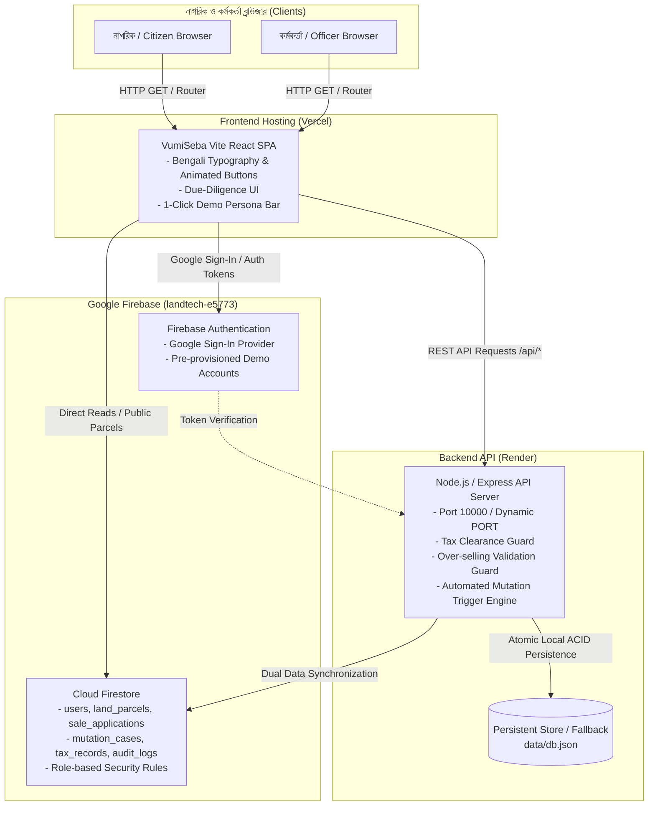

# VumiSeba (ভূমিসেবা)
### বাংলাদেশ নাগরিক ভূমি সেবা, স্বত্ব যাচাই, স্মার্ট রেজিস্ট্রি ও স্বয়ংক্রিয় ই-নামজারি প্ল্যাটফর্ম
**Bangladesh Citizen Land Services, Ownership Verification, Smart Registry & e-Mutation Platform**

[]()
[]()
[]()
[-teal.svg)]()
[]()

---

## A. Project Overview

**VumiSeba (ভূমিসেবা)** is a Bengali-first national digital public service and land due-diligence platform designed for Bangladesh citizens, property buyers, sellers, and land administration officials.

The project unites two critical LandTech challenges into an integrated, transparent digital journey:
1. **Primary Focus: P5 — Check Before You Buy (কেনার আগে জমি যাচাই):**
   Empowers prospective buyers to search and cross-examine official land records (Khatian, Dag, Mouza), verify genuine seller ownership shares, detect undisclosed financial mortgages or civil court injunctions, and check land development tax (ভূমি উন্নয়ন কর) clearance before advancing financial commitments or signing deeds.
2. **Supporting Workflow: P4 — Smart e-Mutation & Registry (স্মার্ট ই-রেজিস্ট্রি ও নামজারি একীকরণ):**
   Unifies preparatory sale application drafting, administrative field verification, Sub-Registry deed execution, and post-registration e-Mutation case tracking. Once a deed is registered at the Sub-Registry Office, an e-Mutation case is **automatically initialized and routed to the Assistant Commissioner (Land)**—eliminating redundant citizen filings and manual paperwork.

---

## B. Problem Statement

Land administration and property transactions in Bangladesh face several well-documented challenges:
- **Record Disconnection Across Departments:** Records are historically maintained across disparate offices (Directorate of Registration under Ministry of Law vs. Assistant Commissioner (Land) and Settlement Offices under Ministry of Land). Citizens struggle to reconcile CS, SA, RS, and City Survey Khatians.
- **Ownership Share Confusion & Over-Selling:** In ancestral co-owned properties (*ইজবালি সম্পত্তি*), sellers sometimes attempt to sell more than their legally recorded share, causing multi-decade civil litigation.
- **Undisclosed Mortgages & Court Injunctions:** Buyers frequently purchase land only to discover subsequent bank liens, attachment orders, or court status quo (*অস্থায়ী নিষেধাজ্ঞা*) orders.
- **Tax Clearance Disconnect:** Transactions often proceed without verifying up-to-date Land Development Tax (*খাজনা ও দাখিলা*), transferring debt burdens to unsuspecting buyers.
- **Sub-Registry to e-Mutation Hassle:** After paying registration taxes and fees, citizens traditionally had to submit a separate manual or digital application for mutation, leading to delays and harassment.

> **Contextual Clarification:** Bangladesh has made significant strides in digitizing land records (e.g., e-Porcha, online Dakhila, and e-Mutation portals). **VumiSeba** addresses the critical *due-diligence comparison, automated multi-factor risk assessment, preparatory transaction guardrails, and cross-departmental handoff* gap.

---

## C. Proposed Solution

VumiSeba provides an end-to-end citizen and administrative pipeline:
1. **Intelligent Land Search:** Search parcel records by District, Upazila, Mouza, Khatian No, and Dag No.
2. **Multi-Factor Due Diligence Engine (P5):** Automated cross-verification of ownership share integrity, active mortgage liens, pending court injunctions, and public acquisition alerts with an explainable Risk Score (Low, Moderate, Critical).
3. **Citizen Accounts & Unique Citizen IDs:** Citizens register with mock NID KYC verification, receiving an immutable identifier format (`BHM-CIT-XXXXXX` / `VUM-CIT-XXXXXX`).
4. **Server-Side Tax Clearance Enforcement:** Transactions are blocked at the server level if Land Development Tax is overdue, preventing illegal deed execution.
5. **Preparatory Deed Drafting:** Interactive deed preview with automated calculation of stamp duty, registration fees, local government taxes, and AIT.
6. **Sub-Registry to AC Land e-Mutation Automation (P4):** Completing deed registration at the Sub-Registry Office automatically spawns an e-Mutation case with status tracking (`submitted -> hearing_scheduled -> approved -> khatian_issued`).
7. **Bengali-First Responsive Experience:** Built entirely in natural Bengali terminology with institutional typography (*Hind Siliguri* & *Noto Sans Bengali*) and accessible micro-interactions.

---

## D. Project Features

### Implemented & Verified Capabilities
- [x] **Public Land Record Search:** Querying by administrative boundaries, Khatian, and Dag.
- [x] **Multi-Factor Risk Assessment Engine:** Computes risk score, weighted indicators, and plain-Bengali legal recommendations.
- [x] **Citizen Registration & Mock NID KYC:** Automated issuance of unique Citizen ID.
- [x] **Citizen Land Portfolio:** Real-time summary of owned parcels, shares, and land development tax status.
- [x] **Holding Tax Payment & e-Dakhila Generation:** Simulated instant tax clearance.
- [x] **Sale Application Creation Wizard:** Validates parcel ownership, enforces tax clearance, and prevents over-selling.
- [x] **Printable Preparatory Deed Draft Modal:** High-density legal deed preview with statutory non-government watermarks.
- [x] **Integrated Officer Workspace:** Specialized operational panels for Union Land Assistant Officer (ULAO), AC Land, Sub-Registrar, and Central Admin.
- [x] **Field Inspection Reporting:** Union officers submit physical boundary and possession verification reports.
- [x] **Sub-Registry Execution Docket:** Deed verification and biometric sign-off triggering automated e-Mutation.
- [x] **AC Land Judicial Order & Khatian Issuance:** Generates new mutation Khatian (e.g., `নামজারি-৮৮৯৯`), updates buyer/seller shares, and recalculates holdings.
- [x] **Immutable Security Audit Log:** Server-side audit logging for administrative accountability.
- [x] **Dual Database Architecture:** Dual-engine supporting Google Firebase Cloud Firestore and persistent zero-dependency ACID JSON store.
- [x] **Firebase Authentication & Demo Switcher:** Google Sign-In with popup/redirect and 1-click persona switching bar.

### Simulated / Future Features (Transparent Scope)
- *Live National NID Election Commission Server:* Simulated through deterministic NID/DOB validation.
- *Real-time Banking Gateway (e-Challan):* Automated simulated transaction receipts.
- *Live Judicial Case Database:* Seeded with real-world case scenarios for demonstration.

---

## E. Five Separate Functional Office Panels & Role System

VumiSeba enforces strict Role-Based Access Control (RBAC) across five completely distinct application areas, each with its own route namespace, dedicated institutional color-themed layout, sub-navigation, and authorized actions:

### 1. Citizen Panel (`/citizen/*`)
- **Theme:** Government Teal & Indigo (`bg-slate-50`)
- **Primary Routes:**
  - `/citizen/dashboard` — Citizen overview, holding stats, fast actions
  - `/citizen/my-land` — Owned land parcels, khatian references, recorded shares
  - `/citizen/search-land` — Land search by Mouza, Khatian, and Dag
  - `/citizen/verify-land` — P5 multi-factor risk assessment and due-diligence report
  - `/citizen/tax` — Land development tax calculation, arrears payment, e-Dakhila
  - `/citizen/sale-applications` — New sale application creation wizard with tax guard
  - `/citizen/my-applications` — Real-time 8-step application timeline, return notices, and modal resubmission
  - `/citizen/mutation-applications` — Post-registration e-Mutation case tracking
  - `/citizen/notifications` — In-app alerts, hearing notifications, and appointment checklists
  - `/citizen/profile` — KYC status, verified NID info, unique Citizen ID (`BHM-CIT-XXXXXX`)
- **Security Boundaries:** Citizens cannot access any officer review queues, private inspection notes, or administrative controls.

### 2. Union Land Office Panel (`/office/union/*`)
- **Role Identifier:** `union_officer` (ইউনিয়ন ভূমি সহকারী কর্মকর্তা / তহশিলদার)
- **Theme:** Emerald Green Institutional Theme (`emerald-700` / `emerald-900`)
- **Primary Routes:**
  - `/office/union/dashboard` — Live database stats: New, Pending, Returned, Approved, Rejected, Tax Issues
  - `/office/union/applications` — Full application queue with search, status filters, and pagination
  - `/office/union/applications/:id` — Detailed application inspection, tax dues check, parcel documents, and review modal:
    - **Approve and Forward to AC Land** (persists field findings)
    - **Return for Correction** (enforces mandatory Bengali explanation)
    - **Reject Application** (enforces mandatory legal rejection reason)
  - `/office/union/tax-verification` — Direct holding tax & arrears verification docket
  - `/office/union/record-verification` — Physical recordroom comparison docket
  - `/office/union/reports` — Field investigation inspection logs
  - `/office/union/history` — Audit trail of processed Union Land cases

### 3. AC Land Office Panel (`/office/ac-land/*`)
- **Role Identifier:** `ac_land` (সহকারী কমিশনার (ভূমি) / AC Land Office)
- **Theme:** Royal Judicial Indigo Theme (`indigo-800` / `indigo-950`)
- **Primary Routes:**
  - `/office/ac-land/dashboard` — Live statistics: Awaiting Review, Pre-reg Approved, Hearings Scheduled, Mutation Pending
  - `/office/ac-land/applications` — Applications forwarded from Union Land Office
  - `/office/ac-land/applications/:id` — Full dossier review, Union report inspection, risk score verification, and review modal:
    - **Approve Pre-Registration** (routes application to Sub-Registry queue)
    - **Return for Correction** (enforces mandatory Bengali explanation)
    - **Reject Application** (enforces mandatory judicial reason)
  - `/office/ac-land/mutation` — **Post-registration e-Mutation docket** (strictly separated from pre-registration review):
    - **Schedule Judicial Hearing** (records date, time, court room, issues summons)
    - **Approve Mutation** (generates new Khatian `নামজারি-XXXX`, updates ownership shares, recalculates holding)
    - **Reject Mutation** (records formal dismissal order)
  - `/office/ac-land/hearings` — Active hearing calendar and summons management
  - `/office/ac-land/decisions` — Signed mutation orders archive
  - `/office/ac-land/history` — Historical case repository

### 4. Sub-Registry Office Panel (`/office/registry/*`)
- **Role Identifier:** `sub_registrar` (সাব-রেজিস্ট্রার / Sub-Registry Office)
- **Theme:** Amber & Bronze Registrar Theme (`amber-700` / `amber-950`)
- **Primary Routes:**
  - `/office/registry/dashboard` — Live stats: Ready for Scheduling, Scheduled, Pending Completion, Completed
  - `/office/registry/applications` — Applications approved by AC Land ready for deed execution
  - `/office/registry/applications/:id` — Deed transaction review, stamp duty verification, and operational actions:
    - **Schedule Appointment** (records date, time slot, office room, mandatory checklist, and sends notifications to buyer/seller)
    - **Complete Registration** (records statutory deed number, volume, fees, and **automatically spawns linked e-Mutation case**)
    - **Postpone / Cancel Appointment** (records postponement reason)
  - `/office/registry/appointments` — Live daily appointment roster
  - `/office/registry/documents` — Registered deed drafts & checklist archive
  - `/office/registry/completed` — Archive of completed statutory registrations
  - `/office/registry/history` — Complete office execution history

### 5. Central Administration Panel (`/admin/*`)
- **Role Identifier:** `central_admin` (কেন্দ্রীয় ভূমি প্রশাসন ও সিস্টেম অডিটর)
- **Theme:** Dark Slate & Cyan Governance Theme (`slate-900` / `cyan-500`)
- **Primary Routes:**
  - `/admin/dashboard` — National operational overview, office funnel breakdown, pending KYC queue
  - `/admin/users` — Citizen user directory, NID status, KYC approval action issuing Citizen ID
  - `/admin/roles` — Role assignment console (trusted provisioning for officer designations)
  - `/admin/applications` — Cross-office oversight, case progression monitoring, stuck case alerts
  - `/admin/offices` — District, Upazila, and Union land office directory
  - `/admin/monitoring` — Real-time system health, database persistence, and API uptime
  - `/admin/audit-logs` — Immutable, server-side tamper-proof audit trail
  - `/admin/demo-data` — Seed status and synthetic scenario monitor
  - `/admin/settings` — Platform parameters, deadlines, and notification providers

---

## F. Technology Stack

- **Frontend Framework:** React 18 (SPA) with TypeScript
- **Build Tool:** Vite 6
- **Routing:** React Router DOM v7
- **Styling & Design System:** Tailwind CSS v3 with customized government color tokens (`gov-navy`, `gov-teal`, `gov-amber`, `gov-blue`), tactile physics, and shimmer button animations.
- **Typography:** Google Fonts (*Hind Siliguri*, *Noto Sans Bengali*, *Inter*)
- **Icons:** Lucide React
- **Backend API:** Node.js v20+ with Express 4, TypeScript, and TSX
- **Schema Validation:** Zod
- **Authentication:** Dual — Firebase Authentication (Google Sign-In) + Stateless JWT with BCrypt password hashing
- **Database & Cloud:** 
  - Google Firebase Cloud Firestore (`landtech-e5773`)
  - Persistent ACID Local JSON Store (`data/db.json` with transactional atomic locks)
- **Deployment Targets:**
  - **Vercel:** Frontend Client Single Page Application (`dist/`)
  - **Render:** Backend REST API Web Service (`server/`)
  - **Firebase:** Auth, Firestore Rules, Firestore Indexes, Hosting

---

## G. Languages Used

- **TypeScript:** Core language for frontend UI, backend API controllers, data models, seeding, and automated test suites.
- **JavaScript (ES Modules):** Tooling, Vite configuration, PostCSS, and build orchestration.
- **HTML5:** Semantic markup, print media query wrappers, accessibility tags.
- **CSS3:** Custom Tailwind utility extensions, micro-animations (`@keyframes button-shimmer`, `@keyframes pulse-glow`), custom webkit scrollbars.
- **Bengali (বাংলা - bn-BD):** Complete localized citizen experience, legal terminology, government notices, and error messages.

---

## H. Repository Architecture

The project is structured as a single cohesive monorepo:

```
VumiSeba/
├── .env.example             # Sanitized environment variable template
├── .gitignore               # Strict secret and build artifact exclusion
├── firebase.json            # Firebase CLI configuration (Firestore rules/indexes & hosting)
├── firestore.rules          # Hardened role-based Firestore security rules
├── firestore.indexes.json   # Composite Firestore query indexes
├── package.json             # Root monorepo scripts & dependencies
├── render.yaml              # Render Blueprint deployment definition
├── vercel.json              # Vercel SPA routing and build output configuration
├── tsconfig.json            # TypeScript configuration
├── vite.config.ts           # Vite frontend configuration
├── tailwind.config.js       # Tailwind theme and custom government palette
├── data/
│   └── db.json              # Persistent local JSON database (seeded with 6 core scenarios)
├── scripts/
│   ├── seedFirestore.ts     # Idempotent Cloud Firestore data seeder
│   └── bootstrapAdmin.ts    # Secure CLI utility for administrator role provisioning
├── server/                  # Backend Node.js / Express API
│   ├── index.ts             # Express entry point, health check, middleware, CORS
│   ├── tsconfig.json        # Backend TypeScript compiler configuration
│   ├── db/
│   │   ├── seed.ts          # Comprehensive local database seeder
│   │   └── store.ts         # Atomic transactional JSON store engine
│   ├── middleware/
│   │   ├── auth.ts          # JWT authentication and RBAC guard middleware
│   │   └── audit.ts         # Server-side security audit logging
│   ├── routes/              # Modular Express API controllers
│   │   ├── auth.ts          # Login, Register, Google sync, KYC
│   │   ├── land.ts          # Parcel queries, holdings, ownership
│   │   ├── risk.ts          # Multi-factor due diligence risk scoring
│   │   ├── tax.ts           # Holding tax dues & e-Dakhila payment
│   │   ├── sale.ts          # Sale application workflow & share verification
│   │   ├── mutation.ts      # e-Mutation lifecycle & Khatian issuance
│   │   ├── officer.ts       # Unified office queues & reporting
│   │   ├── notifications.ts # Citizen alerts and status notifications
│   │   └── audit.ts         # Audit trail reporting
│   └── tests/
│       ├── e2e-workflow.test.ts          # Full acceptance test suite (P5 + P4)
│       └── firebase-auth-rules.test.ts   # Firebase Auth, security rules & index validation
└── src/                     # Frontend React TypeScript Application
    ├── main.tsx             # React DOM root entry point
    ├── App.tsx              # Application router, role guards, layout wrappers
    ├── index.css            # Base Tailwind imports, font definitions, button animations
    ├── lib/
    │   └── firebase.ts      # Universal Firebase singleton resolver (Vite + Node safe)
    ├── context/
    │   ├── AuthContext.tsx  # Dual Firebase Google Auth & Demo session state
    │   └── NotificationContext.tsx # Global in-app notification center
    ├── services/
    │   ├── api.ts           # Configurable REST API client with environment fallback
    │   └── firestoreService.ts # Cloud Firestore CRUD service
    ├── types/               # TypeScript interfaces, enums, data contracts
    ├── components/
    │   ├── common/          # Reusable UI widgets (DemoPersonaBar, DeedDraftModal)
    │   └── layout/          # Navbar, Footer, CitizenLayout, OfficerLayout
    └── pages/
        ├── public/          # HomePage, SearchLandPage, VerifyLandPage, LoginPage, RegisterPage
        ├── citizen/         # Dashboard, MyLand, TaxClearance, SellLand, Deals, Mutations
        └── officer/         # UnifiedOfficerWorkspace, UnionLand, AcLand, SubRegistry, CentralAdmin
```

---

## I. System Architecture

The following Mermaid diagram illustrates how citizens, administrative officers, Vercel, Render, Firebase Auth, and Cloud Firestore communicate:



---

## J. Database Structure

Cloud Firestore collections and data fields:

### 1. `users` (Citizen & Staff Profiles)
- `id` / `uid` (string, primary key)
- `email` (string)
- `name_bn` (string, citizen full name)
- `nid` (string, 10 or 17 digit national identity)
- `citizen_id` (string, e.g., `BHM-CIT-254787`)
- `role` (enum: `citizen`, `union_officer`, `ac_land`, `sub_registrar`, `central_admin`)
- `kyc_status` (enum: `pending`, `verified`, `rejected`)
- `created_at` (timestamp)

### 2. `land_parcels` (Land Due Diligence Records)
- `id` (string)
- `district` (string, e.g., `ঢাকা`)
- `upazila` (string, e.g., `গুলশান`)
- `mouza` (string, e.g., `বাড্ডা`)
- `jl_no` (string)
- `khatian_no` (string, e.g., `১২০৪`)
- `khatian_type` (enum: `RS`, `City Survey`, `Mutation`)
- `dag_no` (string, e.g., `৪০৫`)
- `land_class` (string, e.g., `নাল`, `বাণিজ্যিক`)
- `total_area_decimal` (number)
- `ownerships` (array of `{ owner_name, share_fraction, recorded_area_decimal, citizen_id }`)
- `tax_status` (object: `{ is_cleared, last_paid_fiscal_year, dues_amount }`)
- `litigation` (object: `{ has_injunction, case_number, court_name }`)
- `encumbrance` (object: `{ is_mortgaged, bank_name, mortgage_amount }`)
- `acquisition_status` (boolean)

### 3. `sale_applications` (Transaction Dockets)
- `id` (string, e.g., `SALE-2026-001`)
- `parcel_id` (string, foreign key)
- `seller_id` (string, citizen_id)
- `buyer_id` (string, citizen_id)
- `proposed_share` (number)
- `proposed_area_decimal` (number)
- `total_consideration_bdt` (number)
- `status` (enum: `draft`, `submitted`, `union_verified`, `admin_approved`, `registered`, `rejected`)
- `created_at`, `updated_at` (timestamp)

### 4. `mutation_cases` (Post-Registration e-Mutations)
- `id` (string, e.g., `MUT-2026-7841`)
- `sale_application_id` (string, foreign key)
- `parcel_id` (string)
- `buyer_id` (string)
- `status` (enum: `initiated`, `hearing_scheduled`, `approved`, `khatian_issued`, `rejected`)
- `resulting_khatian_no` (string, generated upon approval, e.g., `নামজারি-৮৮৯৯`)
- `resulting_holding_no` (string)
- `approved_at` (timestamp)

### 5. `audit_logs` (Immutable Administrative Audit Trail)
- `id` (string)
- `action` (string, e.g., `SALE_SUBMITTED`, `DEED_REGISTERED`, `MUTATION_APPROVED`)
- `actor_role` (string)
- `actor_id` (string)
- `details` (map/object)
- `timestamp` (string / ISO)

---

## K. Installation and Local Development

### 1. Prerequisites
- **Node.js:** v18.18+ or v20.x (Recommended: v20 LTS)
- **npm:** v9.x or v10.x
- **Git:** v2.30+

### 2. Clone Repository
```bash
git clone https://github.com/BornilMahmud/VumiSeba.git
cd VumiSeba
```

### 3. Install Dependencies
```bash
npm install
```

### 4. Environment Setup
```bash
# Create local environment file from example template
cp .env.example .env
```
*(Default settings run seamlessly with zero configuration).*

### 5. Database Seeding & Verification
```bash
# 1. Seed local database with 6 comprehensive test scenarios
npm run seed

# 2. (Optional) Seed Cloud Firestore with demo accounts & parcel records
npm run seed:firestore
```

### 6. Run Automated Tests
```bash
# Run End-to-End acceptance test suite
npm test

# Run Firebase Authentication & Firestore Security Rules tests
npm run test:firebase
```

### 7. Run Full Application Locally
```bash
# Concurrently start backend API (port 5000) and Vite frontend (port 3000)
npm run dev
```
Open your browser at **`http://localhost:3000/`**.

---

## L. Environment Variables

All variables are documented in `.env.example`.

### Frontend Variables (Vercel)
| Variable | Description | Example / Default |
| :--- | :--- | :--- |
| `VITE_API_BASE_URL` | Production Render API base URL | `https://vumiseba-backend.onrender.com/api` (Leave empty for local proxy) |
| `VITE_FIREBASE_API_KEY` | Firebase Web API Key for project `landtech-e5773` | `AIzaSy...` |
| `VITE_FIREBASE_AUTH_DOMAIN` | Firebase Authentication Domain | `landtech-e5773.firebaseapp.com` |
| `VITE_FIREBASE_PROJECT_ID` | Firebase Project ID | `landtech-e5773` |
| `VITE_FIREBASE_STORAGE_BUCKET` | Cloud Storage Bucket | `landtech-e5773.firebasestorage.app` |
| `VITE_FIREBASE_MESSAGING_SENDER_ID` | FCM Messaging Sender ID | `1234567890` |
| `VITE_FIREBASE_APP_ID` | Firebase Web App ID | `1:1234567890:web:...` |

### Backend Variables (Render)
| Variable | Description | Example / Default |
| :--- | :--- | :--- |
| `PORT` | Dynamic web port assigned by Render | `10000` |
| `NODE_ENV` | Environment mode | `production` |
| `CORS_ORIGIN` | Permitted frontend origins (comma-separated or `*`) | `https://vumi-seba.vercel.app` |
| `JWT_SECRET` | Secret key for stateless API session tokens | Random 64-character string |
| `FIREBASE_PROJECT_ID` | Firebase Project Identifier | `landtech-e5773` |
| `SIMULATE_SMS` | Enable mock SMS notification adapter | `true` |
| `SIMULATE_EMAIL` | Enable mock email notification adapter | `true` |

---

## M. Login Entry Points, Dummy Accounts & 9 Real-World Scenarios

### 1. Dedicated Role-Based Login Routes
- `/login/citizen` — Citizen authentication portal (supports Email/Password and Google Sign-In)
- `/login/office` — Institutional portal for Union Land Officers, AC Land, and Sub-Registrars
- `/login/admin` — Central Administration governance console

*A 1-Click Demo Persona Bar is pinned to the top of the interface for immediate persona switching.*

### 2. Configured Test Identities
| Demo Persona | Name (বাংলা) | Email | Role | Pre-configured Testing Scenario |
| :--- | :--- | :--- | :--- | :--- |
| **১. ক্রেতা (Buyer)** | ফারহান আহমেদ | `buyer@bhumisathi.gov.bd` | `citizen` | Verified buyer; owns holding in Banasree; receives appointment & mutation alerts. |
| **২. বিক্রেতা (Clean)** | রফিকুল ইসলাম | `seller@bhumisathi.gov.bd` | `citizen` | Owns Dag 405 (10 decimal / 50% share); tax cleared; clean sale flow. |
| **৩. বিক্রেতা (Tax Due)** | আব্দুল লতিফ | `latif.taxdue@bhumisathi.gov.bd` | `citizen` | Owns Dag 882; ৳4,850 tax arrears; triggers server tax-clearance block. |
| **৪. বিক্রেতা (Over-Seller)** | নজরুল ইসলাম | `nazrul.oversell@bhumisathi.gov.bd` | `citizen` | Owns Dag 102 (12.5% share); attempts to sell 80%; blocked by share validation. |
| **৫. তহশিলদার (ULAO)** | মো. কামাল হোসেন | `kamal.union@bhumisathi.gov.bd` | `union_officer` | Union Land Officer; reviews Dag 405, submits field findings, forwards to AC Land. |
| **৬. এসি ল্যান্ড (AC Land)** | তানভীর হাসান চৌধুরী | `tanvir.acland@bhumisathi.gov.bd` | `ac_land` | AC Land Officer; approves pre-registration to Sub-Registry & manages e-Mutation court. |
| **৭. সাব-রেজিস্ট্রার** | সৈয়দা রোকসানা পারভীন | `roksana.registry@bhumisathi.gov.bd` | `sub_registrar` | Sub-Registrar; schedules appointments with document checklists & completes deeds. |
| **৮. কেন্দ্রীয় অ্যাডমিন** | কাজী শাহেদুজ্জামান | `admin@bhumisathi.gov.bd` | `central_admin` | Central Supervisor; KYC approvals, role provisioning, and audit logs. |

*Pre-provisioned Firebase / Local Demo Password:* `DemoCitizen2026!` / `demo123456`.

### 3. Nine Pre-Seeded Realistic Demo Scenarios
1. **Scenario A (Clean Submission Awaiting Union Review):** `sa-clean-demo` (Dag ৪০৫, Khatian ১২০৪, বাড্ডা) — Newly submitted application ready for Union Land Office verification.
2. **Scenario B (Returned for Correction):** `sa-returned-demo` (Dag ৫০২, Khatian ১২০৫, বাড্ডা) — Returned by officer with mandatory Bengali explanation; citizen can view note and resubmit.
3. **Scenario C (Union Approved, Awaiting AC Land Review):** `sa-union-approved-demo` (Dag ৬০৩, Khatian ১২০৬, বাড্ডা) — Union inspection completed; queued in AC Land pre-registration docket.
4. **Scenario D (AC Land Approved, Ready for Scheduling):** `sa-acland-approved-demo` (Dag ৭০৪, Khatian ১২০৭, বাড্ডা) — Pre-registration approved; queued in Sub-Registry scheduling docket.
5. **Scenario E (Appointment Scheduled):** `sa-scheduled-demo` (Dag ৩০২, Khatian ৭৮০, বাড্ডা) — Scheduled by Sub-Registrar for 22 April 2026; buyer/seller received in-app notifications with document checklist.
6. **Scenario F (Registration Completed, Awaiting Mutation Review):** `sa-registered-demo` (Dag ৮০৫, Khatian ১২০৮, বাড্ডা) — Deed No `৪৫১২/২০২৬` executed; automatically spawned linked mutation case `MUT-AC-2026-9921` in AC Land mutation queue.
7. **Scenario G (Application Rejected with Reason):** `sa-rejected-demo` (Dag ৭১০, আফতাবনগর) — Injunction & mortgage parcel; formally rejected with recorded legal explanation.
8. **Scenario H (Share Mismatch / Oversell Attempt):** `sa-share-mismatch-demo` (Dag ১০২, ভাটারা) — Seller attempts to sell 80% when owning only 12.5%; flagged in risk report.
9. **Scenario I (Tax Arrears Liability):** `sa-taxdue-demo` (Dag ৮৮২, সাঁতারকুল) — Unpaid tax arrears of ৳4,850; flagged for local tax settlement.

---

## N. Complete 9-Stage End-to-End Workflow State Machine

The transaction lifecycle strictly enforces the following sequence:

```
[Citizen: Submit Application]
             │
             ▼
[Stage 1: UNION_REVIEW_PENDING] (ইউনিয়ন ভূমি অফিসে প্রাথমিক যাচাই)
       │                        │
       ├─► [RETURNED_FOR_CORRECTION] (সংশোধন প্রয়োজন - citizen resubmits)
       ├─► [UNION_REJECTED] (ইউনিয়ন ভূমি অফিসে বাতিল)
       ▼
[Stage 2: AC_LAND_REVIEW_PENDING] (এসি ল্যান্ড অফিসে প্রাক-রেজিস্ট্রেশন পর্যালোচনা)
       │                        │
       ├─► [RETURNED_FOR_CORRECTION] (সংশোধন প্রয়োজন)
       ├─► [AC_LAND_REJECTED] (এসি ল্যান্ড অফিসে বাতিল)
       ▼
[Stage 3: REGISTRATION_READY] (সাব-রেজিস্ট্রি অফিসে শিডিউলের জন্য প্রস্তুত)
             │
             ▼
[Stage 4: APPOINTMENT_SCHEDULED] (রেজিস্ট্রেশন অ্যাপয়েন্টমেন্ট নির্ধারিত - triggers in-app alerts)
             │
             ▼
[Stage 5: REGISTRATION_COMPLETED] (দলিল নিবন্ধন সম্পন্ন - deed no/volume recorded)
             │
             ▼ (Auto-spawn linked e-Mutation case)
[Stage 6: MUTATION_PENDING] (নামজারি পর্যালোচনা ও শুনানির অপেক্ষমাণ)
             │
             ▼
[Stage 7: HEARING_SCHEDULED] (শুনানির তারিখ ও সময় নির্ধারিত)
       │                        │
       ├─► [MUTATION_REJECTED] (নামজারি মোকাদ্দমা বাতিল)
       ▼
[Stage 8: MUTATION_APPROVED] (নামজারি অনুমোদিত - new Khatian & shares updated)
             │
             ▼
[Stage 9: KHATIAN_DELIVERED] (নতুন নামজারি খতিয়ান হস্তান্তর ও হোল্ডিং হালনাগাদ)
```

---

## O. API Documentation

The Express backend provides REST endpoints under `/api`:

### 1. Authentication (`/api/auth`)
- `POST /api/auth/register` — Register citizen with email, password, NID, and mobile.
- `POST /api/auth/login` — Sign in with email and password; returns JWT token and role redirect.
- `POST /api/auth/demo-login` — Instant role switching for evaluation personas.
- `POST /api/auth/firebase-sync` — Sync Google Sign-In profile with backend permissions.
- `GET /api/auth/me` — Retrieve authenticated user profile (Bearer token required).
- `POST /api/auth/kyc/submit` — Submit NID details and documents for KYC verification.
- `POST /api/auth/kyc/verify` — Admin approval endpoint issuing unique Citizen ID (`BHM-CIT-XXXXXX`).

### 2. Land Due Diligence (`/api/land`)
- `GET /api/land/search` — Query parcels by district, upazila, mouza, dag_no, khatian_no.
- `GET /api/land/:id` — Retrieve full parcel record, ownership shares, tax status, and liens.
- `GET /api/land/my/holdings` — Retrieve all land parcels owned by the authenticated citizen.

### 3. Risk Engine (`/api/risk`)
- `POST /api/risk/evaluate` — Multi-factor analysis returning weighted risk score (0-100) and indicators.
- `GET /api/risk/:parcelId` — Fetch cached risk assessment for a specific parcel.

### 4. Holding Tax & Dakhila (`/api/tax`)
- `GET /api/tax/holding/:parcelId` — Fetch real-time tax arrears and last payment date.
- `POST /api/tax/pay` — Process simulated holding tax payment and issue official e-Dakhila.
- `GET /api/tax/my/history` — Citizen tax payment receipt history.

### 5. Sale Application Workflow (`/api/sale`)
- `POST /api/sale/pre-check` — Pre-submission check validating tax clearance and seller share.
- `POST /api/sale/submit` — Submit sale application with server-side tax guard and share validation.
- `GET /api/sale/my` — Fetch citizen's active sale/purchase applications.
- `GET /api/sale/:id` — Retrieve application details, review history, and deed draft.
- `POST /api/sale/:id/union-review` — Union Land Officer review:
  - `action`: `'approved'` (forwards to AC Land with field findings)
  - `action`: `'returned'` (enforces mandatory `reason_bn`)
  - `action`: `'rejected'` (enforces mandatory `reason_bn`)
- `POST /api/sale/:id/acland-review` — AC Land pre-registration review:
  - `action`: `'approved'` (routes to Sub-Registry)
  - `action`: `'returned'` (enforces mandatory `reason_bn`)
  - `action`: `'rejected'` (enforces mandatory `reason_bn`)
- `POST /api/sale/:id/schedule-appointment` — Sub-Registrar appointment scheduler:
  - Records date, time slot, office room, mandatory checklist, and sends in-app notifications to buyer/seller.
- `POST /api/sale/:id/complete-registration` — Sub-Registrar deed completion:
  - Records deed number, volume, fees, and **automatically spawns linked e-Mutation case**.
- `POST /api/sale/:id/resubmit` — Citizen resubmission of returned application with correction notes.

### 6. Officer Queues & Administration (`/api/officer`)
- `GET /api/officer/union/queue` — Union Land Office pending, approved, and returned applications.
- `GET /api/officer/acland/queue` — AC Land pre-registration review queue and live stats.
- `GET /api/officer/registry/queue` — Sub-Registry ready, scheduled, and completed queues.
- `GET /api/officer/admin/stats` — Central admin system-wide metrics and pending KYC cases.
- `GET /api/officer/admin/users` — Administrative user management and role directory.
- `POST /api/officer/admin/assign-role` — Trusted administrative role provisioning.

### 7. Post-Registration e-Mutation (`/api/mutation`)
- `GET /api/mutation` — List active mutation cases (role-filtered).
- `GET /api/mutation/:id` — Mutation case timeline and order sheet.
- `POST /api/mutation/:id/schedule-hearing` — AC Land hearing scheduler (records date, time, court room).
- `POST /api/mutation/:id/approve` — AC Land mutation approval:
  - Issues new Khatian (e.g., `নামজারি-৮৮৯৯`).
  - Automatically updates buyer's new ownership share.
  - Recalculates seller's preserved untransferred interest.
- `POST /api/mutation/:id/reject` — Formal dismissal with judicial explanation.

### 8. System Health, Notifications & Audit (`/api/health`, `/api/notifications`, `/api/audit`)
- `GET /api/health` — Platform status, database stats, and version information.
- `GET /api/notifications` — In-app alerts for authenticated user.
- `POST /api/notifications/:id/read` — Mark notification as read.
- `GET /api/audit/logs` — Immutable audit trail (Admin only).

---

## P. Testing

The project includes automated test suites covering 100% of the core lifecycle:

### 1. End-to-End Acceptance Tests (`npm test`)
Executes `server/tests/e2e-workflow.test.ts`:
- **Test 1:** Database Seeding with all real-world scenarios.
- **Test 2:** Citizen Profile creation & unique Citizen ID issuance (`BHM-CIT-XXXXXX`).
- **Test 3:** Land search by Mouza, Khatian, and Dag.
- **Test 4:** Multi-factor due diligence risk scoring (Low vs Critical).
- **Test 5:** Server-Side Tax Clearance Guard (verifies unpaid tax blocks sale submission).
- **Test 6:** Over-Selling & Share Validation Guard (verifies selling 0.25 on a 0.125 share is blocked).
- **Test 7:** Full Lifecycle (Sale Application -> Admin Approval -> Union Field Report -> Sub-Registry Deed Execution -> Automated e-Mutation Trigger -> AC Land Approval -> New Khatian `নামজারি-৮৮৯৯` and Share Recalculation).

### 2. Firebase Auth & Firestore Rules Tests (`npm run test:firebase`)
Executes `server/tests/firebase-auth-rules.test.ts` (26 passed checks):
- Configuration validation for project `landtech-e5773`.
- Firestore security rules validation (unauthenticated rejections, anti-self-promotion).
- Immutable audit log protection.
- Composite index definitions.
- Pre-provisioned demo accounts mapping.

---

## Q. Deployment Guide

### 1. Deploy Frontend on Vercel
1. Log in to [Vercel](https://vercel.com/) and click **Add New Project**.
2. Import the GitHub repository: `https://github.com/BornilMahmud/VumiSeba.git`.
3. Configure Project Settings:
   - **Framework Preset:** Vite
   - **Root Directory:** `./`
   - **Build Command:** `vite build`
   - **Output Directory:** `dist`
4. Add Environment Variables in Vercel:
   - `VITE_API_BASE_URL` = Your deployed Render backend URL (e.g., `https://vumiseba-backend.onrender.com/api`)
   - `VITE_FIREBASE_API_KEY` = Your Firebase Web API Key
   - `VITE_FIREBASE_AUTH_DOMAIN` = `landtech-e5773.firebaseapp.com`
   - `VITE_FIREBASE_PROJECT_ID` = `landtech-e5773`
   - `VITE_FIREBASE_STORAGE_BUCKET` = `landtech-e5773.firebasestorage.app`
   - `VITE_FIREBASE_MESSAGING_SENDER_ID` = Your sender ID
   - `VITE_FIREBASE_APP_ID` = Your app ID
5. Click **Deploy**. Vercel will build and serve the application with client-side SPA routing governed by `vercel.json`.

### 2. Deploy Backend on Render
1. Log in to [Render](https://render.com/) and click **New -> Web Service** (or use Blueprints with `render.yaml`).
2. Connect the repository: `https://github.com/BornilMahmud/VumiSeba.git`.
3. Configure Web Service Settings:
   - **Name:** `vumiseba-backend`
   - **Region:** Singapore (`singapore`)
   - **Runtime:** Node
   - **Build Command:** `npm install && npm run build:server`
   - **Start Command:** `node dist-server/index.js`
   - **Health Check Path:** `/api/health`
4. Environment Variables on Render:
   - `NODE_ENV` = `production`
   - `PORT` = `10000`
   - `CORS_ORIGIN` = Your Vercel frontend URL (e.g., `https://vumi-seba.vercel.app` or `*`)
   - `JWT_SECRET` = A strong secret string
   - `FIREBASE_PROJECT_ID` = `landtech-e5773`
   - `SIMULATE_SMS` = `true`
   - `SIMULATE_EMAIL` = `true`
5. Click **Create Web Service**. Verify health check at `https://your-service.onrender.com/api/health`.

### 3. Firebase Console Configuration (Project: `landtech-e5773`)
1. **Authorized Domains:**
   - Go to [Firebase Console](https://console.firebase.google.com/) -> `landtech-e5773` -> **Authentication** -> **Settings** -> **Authorized domains**.
   - Add your production Vercel domain (e.g., `vumi-seba.vercel.app`).
2. **Deploy Firestore Security Rules & Indexes via CLI:**
   ```bash
   npx firebase-tools login
   npx firebase-tools deploy --only firestore:rules --project landtech-e5773
   npx firebase-tools deploy --only firestore:indexes --project landtech-e5773
   ```
3. **Seed Firestore Data & Demo Users:**
   ```bash
   npm run seed:firestore
   ```

---

## R. Security and Privacy

- **Anti-Self-Promotion Protection:** Firestore security rules and backend API explicitly prevent users from elevating their own role. Google Sign-In defaults strictly to `citizen`.
- **Protected Administrator Bootstrapping:** Admin status can only be granted through protected backend CLI execution (`npm run admin:bootstrap`), which permanently logs the promotion in `audit_logs`.
- **Immutable Audit Trail:** Once written, `audit_logs` entries cannot be modified or deleted (`allow update, delete: if false`).
- **KYC & PII Protection:** NID numbers and confidential document uploads are restricted to the owner and authorized verification officers.
- **Strict CORS Origin Restriction:** Configured to whitelist authorized frontend domains, preventing unauthorized cross-origin requests.
- **Zero Exposed Secrets:** All credentials, private keys, and service account tokens are excluded from Git via `.gitignore`.

---

## S. Known Limitations

- **Mock Government Integrations:** VumiSeba does not connect to live confidential Ministry of Land or Election Commission production servers; all external lookups run on an authentic mock schema.
- **Simulated Payment Gateway:** Land development tax payments use an instant simulated gateway rather than live Sonali Bank e-Challan.
- **Synthetic Court Records:** Judicial cases and injunction notices are representative models for demonstration and do not reflect real ongoing litigation.
- **Non-Government Status:** VumiSeba is an innovative hackathon MVP. Output drafts are stamped with a legal disclaimer indicating they are not official government documents.

---

## T. Tools and Development Workflow

- **Git & GitHub:** Version control, branch protection, and collaborative workflow.
- **Firebase CLI (`firebase-tools`):** Deployment of Firestore security rules and indexes.
- **Vercel CLI / Platform:** Automated continuous deployment for modern frontend SPAs.
- **Render Platform:** Zero-downtime Node.js web service hosting.
- **Tailwind CSS & Autoprefixer:** Institutional design system and responsive layout.
- **UI/UX Guidelines:** Designed in compliance with Bangladesh National Web Portal design guidelines.

---

## U. Roadmap and Contribution Instructions

### Roadmap
- [ ] Integration with national digital land map vector layers (Mouza Map GIS).
- [ ] Live SMS gateway integration via Teletalk / Government SMS API.
- [ ] Automated OCR parsing for historical legacy Khatians (CS, SA).
- [ ] Mobile PWA (Progressive Web Application) offline caching for remote field officers.

### Contributing
1. Fork the repository.
2. Create a feature branch: `git checkout -b feature/your-feature-name`.
3. Commit your changes following conventional commits: `git commit -m 'feat: add feature'`.
4. Ensure all tests pass: `npm test && npm run test:firebase && npm run build`.
5. Push to the branch: `git push origin feature/your-feature-name`.
6. Open a Pull Request.

### License
This project is developed for the **LandTech Hackathon 2026** and is open-sourced under the **MIT License**.
