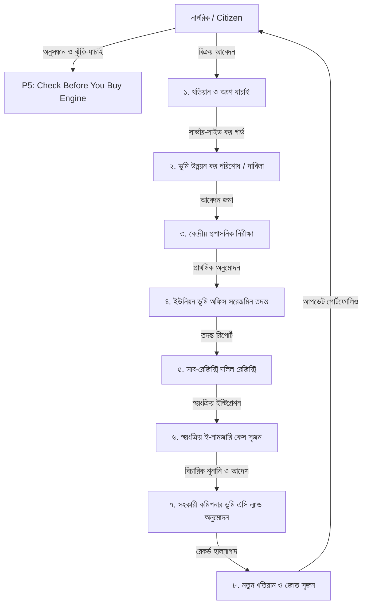

# Bhumisathi (ভূমিসাথী)
### Bangladesh Citizen Land Services, Ownership Verification, Smart Registry & e-Mutation Platform

[]()
[]()
[-teal.svg)]()
[-navy.svg)]()
[]()

---

## 🌟 Executive Summary & Problem Statements Addressed

**Bhumisathi (ভূমিসাথী)** is a Bengali-first national digital public service platform bridging the critical disconnect in Bangladesh land administration. It unites two LandTech challenges into one cohesive citizen journey:

1. **P5 — Check Before You Buy (কেনার আগে যাচাই):**
   Helps prospective land buyers inspect official land records (Khatian, Dag, Mouza), verify seller ownership share portions, confirm real-time land development tax clearance (দাখিলা), and identify critical legal red flags (court injunctions, bank mortgage liens, duplicate sales, and government acquisition notices) before signing or advancing money.

2. **P4 — Smart e-Mutation & Registry (স্মার্ট ই-নামজারি ও সাব-রেজিস্ট্রি ইন্টিগ্রেশন):**
   Connects preparatory deed drafting, tax-clearance validation guards, administrative review, Sub-Registry Office deed execution, and automated post-registration e-Mutation case tracking in a single seamless flow. Once a deed is registered at the Sub-Registry Office, an e-Mutation case is **automatically initialized and assigned to the Assistant Commissioner (Land)** for field verification, hearing, and issuance of a new corrected Khatian.

---

## 🏛️ 6 Core Role-Based Application Areas

| Area | Access Route | Target Roles | Core Capabilities |
| :--- | :--- | :--- | :--- |
| **Area A: Public Portal** | `/`, `/search-land`, `/verify-land`, `/services`, `/how-it-works`, `/help` | General Public, Citizens | Citizen land search, pre-purchase multi-factor risk assessment, fee calculators, citizen guidelines. |
| **Area B: Citizen Workspace** | `/citizen/*` | Verified Buyers & Sellers | Digital Land Portfolio, Holding records, Tax Dakhila clearance, Sale application wizard, preparatory deed preview, e-Mutation tracking, Document vault. |
| **Area C: Union Land Office** | `/officer/union-land` | Union Land Assistant Officer (ULAO) | Field investigation queue, physical possession & boundary checks, tax clearance verification, inspection report submission to AC Land. |
| **Area D: AC Land Court** | `/officer/ac-land` | Assistant Commissioner (Land) | Judicial hearing scheduling, summons notice issuance, formal mutation approval, automatic generation of new Khatian (`KH-MUT-XXXXXX`) and holding (`H-XXXXX`), share recalculation. |
| **Area E: Sub-Registry Office** | `/officer/registry` | Sub-Registrar & Registry Clerks | Approved deed verification docket, biometric/identity check, preparatory deed packet inspection, official registration execution, and automated trigger of linked e-Mutation. |
| **Area F: Central Administration** | `/admin` | Central Supervisors & Audit Officers | National operational overview, Citizen KYC verification queue, unique Citizen ID generation, sale application audit, immutable security audit trail. |

---

## 🏗️ System Architecture (Archify Flow)



---

## 🔒 Security, Integrity & Server-Side Enforcement Rules

1. **Server-Side Tax Clearance Guard:**
   Sale applications strictly reject submission at the API controller level (`/api/sale/submit`) if land development tax for the target parcel is unpaid.
2. **Over-Selling & Share Portion Protection:**
   The backend independently validates that `proposed_share <= seller_available_share`. If a seller attempts to transfer more than their recorded interest, the server returns an HTTP 400 error.
3. **Partial Transfer & Ownership Preservation:**
   When a transaction transfers a portion of a parcel (e.g., 1 decimal out of 10 decimal), the seller's remaining interest (9 decimal / 45% share) is permanently preserved with status `partial_transferred`, while the buyer receives their new active holding.
4. **Unique Citizen ID Constraint:**
   Upon successful KYC approval, the platform issues an immutable, unique citizen identifier in format `BHM-CIT-XXXXXX`.
5. **Non-Government Imitation Disclaimer:**
   All printable draft deeds prominently bear the statutory watermark:
   `DEMO DRAFT — NOT AN OFFICIAL GOVERNMENT DOCUMENT`.

---

## 🚀 Quickstart & Running Locally

### 1. Prerequisites
- Node.js (v18.x or v20.x recommended)
- npm (v9.x or v10.x)

### 2. Installation
```bash
# Clone or navigate to the project directory
cd LandTech

# Install all backend and frontend dependencies
npm install
```

### 3. Environment Variables
Copy the example environment configuration:
```bash
cp .env.example .env
```
*(Default settings are pre-configured to run out of the box with the persistent zero-config local engine).*

### 4. Database Seeding & Verification Tests
```bash
# Seed the database with all 7 comprehensive test scenarios
npm run seed

# Run the automated End-to-End acceptance test suite
npm test
```

### 5. Launch Full Application
```bash
# Start both backend server (port 5000) and frontend client (port 3000)
npm run dev
```
Open your browser at: **`http://localhost:3000/`**

---

## 👥 Demo Personas & 1-Click Role Switcher

For evaluation, a **1-Click Demo Persona Bar** is pinned to the top of every page. You can switch between personas instantly without manual login:

| Persona | Name | Role | Pre-configured Context |
| :--- | :--- | :--- | :--- |
| **ক্রেতা (Buyer)** | ফারহান আহমেদ | `citizen` | Prospective land buyer; owns parcel in Banasree; ready to purchase land. |
| **বিক্রেতা (Seller - Clean)** | রফিকুল ইসলাম | `citizen` | Owns Dag 405 (10 decimal / 50% share); tax cleared; ready for clean transfer. |
| **বিক্রেতা (Tax Due)** | আব্দুল লতিফ | `citizen` | Owns Dag 882; has ৳4,850 tax arrears; demonstrates server tax-block. |
| **বিক্রেতা (Over-Seller)** | নজরুল ইসলাম | `citizen` | Owns Dag 201 (12.5% share); attempts to sell 25%; triggers over-selling block. |
| **তহশিলদার (ULAO)** | মো. কামাল হোসেন | `union_officer` | Union Land Assistant Officer; manages field investigation queue. |
| **এসি ল্যান্ড (AC Land)** | তানভীর হাসান চৌধুরী | `ac_land` | Assistant Commissioner (Land); conducts hearings and approves mutations. |
| **সাব-রেজিস্ট্রার** | সৈয়দা রোকসানা পারভীন | `sub_registrar` | Sub-Registrar; executes deeds and triggers post-registration e-Mutation. |
| **অ্যাডমিন** | কাজী শাহেদুজ্জামান | `central_admin` | Central Supervisor; reviews KYC and monitors system-wide audit logs. |

*Default password for all demo accounts:* `demo123456`

---

## 📊 Test Scenarios Included in Seed Dataset

1. **Scenario 1 — Clean Transfer ( Dag ৪০৫, বাড্ডা):**
   Seller has 50% share; tax cleared; passes P5 risk assessment; completes sale -> deed -> e-mutation -> new Khatian `নামজারি-৮৮৯৯`.
2. **Scenario 2 — Tax Due Block ( Dag ৮৮২, সাঁতারকুল):**
   Seller Abdul Latif has ৳4,850 unpaid tax; sale application is strictly blocked until demo payment clearance is completed.
3. **Scenario 3 — Over-Selling Mismatch ( Dag ২০১, নতুন বাজার):**
   Seller Nazrul Islam has 0.125 share; attempts to transfer 0.25 share; blocked by server share validation engine.
4. **Scenario 4 — Duplicate Sale Risk ( Dag ৩০২, বাড্ডা প্রগতি সরণি):**
   Two active competing sale applications on the same parcel; flagged as duplicate-sale risk.
5. **Scenario 5 — Document Discrepancy ( Dag ৬১০, রামপুরা উলন):**
   Khatian area (6.20 decimal) does not match deed reference (8.50 decimal); flagged for manual deed examination.
6. **Scenario 6 — Court Injunction & Mortgage Lien ( Dag ৭১০, আফতাবনগর):**
   Pending civil court case #104/2023 with injunction + ৳42,50,000 Agrani Bank lien; triggers Critical Risk warning.

---

## 🛠️ Technology Stack & Design System

- **Frontend:** React 18, Vite, TypeScript, Tailwind CSS, Lucide Icons, Google Fonts (*Hind Siliguri* & *Noto Sans Bengali*).
- **Backend:** Node.js, Express, TypeScript, Zod, JWT Authentication, Role-Based Access Control (RBAC).
- **Database Architecture:**
  - **Firebase Firestore Ready:** Includes production `firestore.rules`, `firebase.json`, and `firestore.indexes.json`.
  - **Zero-Dependency Persistent Engine:** Built-in atomic JSON store (`server/db/store.ts` + `data/db.json`) ensuring 100% offline hackathon persistence across restarts.
- **Visual Design Standard:** Strictly designed following **UI/UX Pro Max** institutional government portal guidelines:
  - Deep Navy (`#0F172A`) navigation headers.
  - Government Teal (`#0D9488`) and Emerald (`#16A34A`) for positive, verified states.
  - Institutional Amber (`#D97706`) for cautionary notices.
  - Restrained Crimson (`#DC2626`) for critical legal flags.
  - High information density with tabular layout for officers instead of oversized marketing cards.

---

## 🔥 Firebase Integration & Cloud Architecture (Project: `landtech-e5773`)

Bhumisathi connects directly to **Google Firebase** for enterprise authentication, role management, and distributed NoSQL data persistence:

- **Firebase Project ID:** `landtech-e5773`
- **Authentication Provider:** Google Sign-In (`GoogleAuthProvider`) + Pre-provisioned Demo Accounts (`signInWithEmailAndPassword`)
- **Database Engine:** Cloud Firestore (`firestore.rules` + `firestore.indexes.json`)
- **Web App Hosting:** Firebase Hosting (`dist/` with single-page app rewrite in `firebase.json`)

### 1. Firebase Client Configuration
Set your web credentials in `.env` (refer to `.env.example`):
```env
# Firebase Client Configuration for project landtech-e5773
VITE_FIREBASE_API_KEY=AIzaSy...
VITE_FIREBASE_AUTH_DOMAIN=landtech-e5773.firebaseapp.com
VITE_FIREBASE_PROJECT_ID=landtech-e5773
VITE_FIREBASE_STORAGE_BUCKET=landtech-e5773.firebasestorage.app
VITE_FIREBASE_MESSAGING_SENDER_ID=...
VITE_FIREBASE_APP_ID=...
VITE_FIREBASE_MEASUREMENT_ID=...
```

### 2. Firebase Console Configuration Steps (For Project Owner)
If not already enabled in the `landtech-e5773` Firebase Console:
1. **Enable Authentication Providers:**
   - Go to [Firebase Console](https://console.firebase.google.com/) -> Project `landtech-e5773` -> **Authentication** -> **Sign-in method**.
   - Enable **Google** provider and configure support email.
   - Enable **Email/Password** provider (enables the pre-provisioned demo accounts).
2. **Authorize Domains:**
   - Under Authentication -> **Settings** -> **Authorized domains**, ensure `localhost` and `127.0.0.1` are present. Add any deployed production domain.
3. **Initialize Cloud Firestore:**
   - Go to **Firestore Database** -> **Create Database** (if not created). Choose production rules and a regional location (e.g. `asia-south1`).
4. **Deploy Security Rules & Indexes:**
   ```bash
   # Login to Firebase CLI
   npx firebase-tools login

   # Deploy hardened Firestore security rules
   npx firebase-tools deploy --only firestore:rules --project landtech-e5773

   # Deploy required query indexes
   npx firebase-tools deploy --only firestore:indexes --project landtech-e5773
   ```

### 3. Demo Account Provisioning & Firestore Data Seeder
Run the idempotent seeding script to automatically register all 5 demo accounts in Firebase Authentication and seed the 6 core scenarios into Cloud Firestore:
```bash
# Seed Cloud Firestore and provision demo accounts
npm run seed:firestore
```

| Demo Identity | Email | Password | Role | Access Level |
| :--- | :--- | :--- | :--- | :--- |
| **১. ডেমো নাগরিক** | `demo-citizen@bhumisathi.gov.bd` | `DemoCitizen2026!` | `citizen` | Citizen Dashboard (`/citizen`) |
| **২. ইউনিয়ন কর্মকর্তা** | `demo-union@bhumisathi.gov.bd` | `DemoUnion2026!` | `union_officer` | Union Land Office (`/officer/union-land`) |
| **৩. এসি ল্যান্ড** | `demo-acland@bhumisathi.gov.bd` | `DemoAcLand2026!` | `ac_land` | AC Land Court (`/officer/ac-land`) |
| **৪. সাব-রেজিস্ট্রার** | `demo-subreg@bhumisathi.gov.bd` | `DemoSubReg2026!` | `sub_registrar` | Sub-Registry Office (`/officer/registry`) |
| **৫. সিস্টেম অ্যাডমিন** | `demo-admin@bhumisathi.gov.bd` | `DemoAdmin2026!` | `central_admin` | Central Supervisor (`/officer`) |

### 4. Administrator Role Bootstrap Utility
To promote any registered citizen or staff member to Central Administrator securely via CLI:
```bash
npm run admin:bootstrap <user-email-or-uid>
```
*Note: Users cannot self-promote. Ordinary Google sign-ins strictly receive the `citizen` role. Role promotions are verified and permanently recorded in `audit_logs`.*

### 5. Automated Verification & Testing
```bash
# 1. Run full application end-to-end acceptance workflow
npm test

# 2. Run Firebase Authentication, Security Rules & Index verification suite
npm run test:firebase

# 3. Compile full production bundle
npm run build
```

---

## 📜 Statutory Notice

> **আইনানুগ সতর্কবার্তা:**
> ভূমিসাথী (Bhumisathi) একটি ডিজিটাল উদ্ভাবনী ডেমো প্ল্যাটফর্ম। এই প্ল্যাটফর্মের খসড়া দলিল, ঝুঁকি মূল্যায়ন বা প্রক্রিয়াকরণ কোনো অবস্থাতেই গণপ্রজাতন্ত্রী বাংলাদেশ সরকারের সাব-রেজিস্ট্রার কার্যালয়ের নিবন্ধিত মূল দলিল, সহকারী কমিশনার (ভূমি) এর সার্টিফাইড খতিয়ান বা আদালতের বিচারিক স্বত্ব ঘোষণার সরাসরি বিকল্প নয়।
