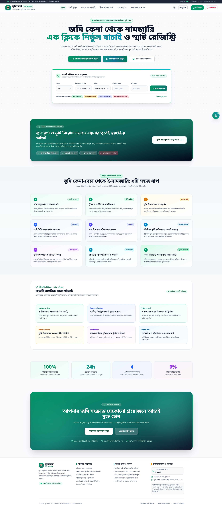
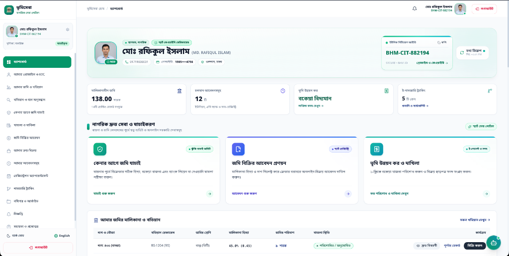
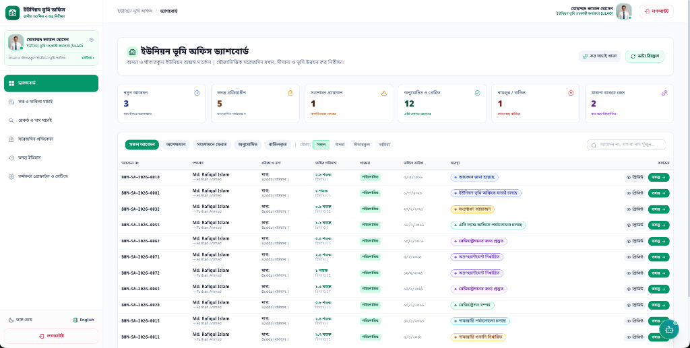
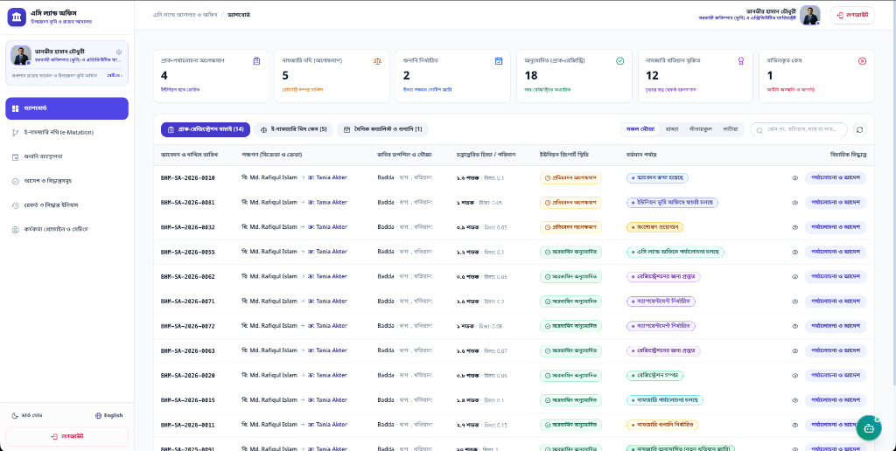
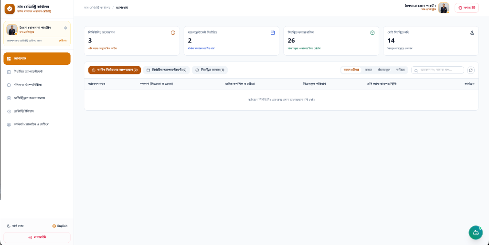
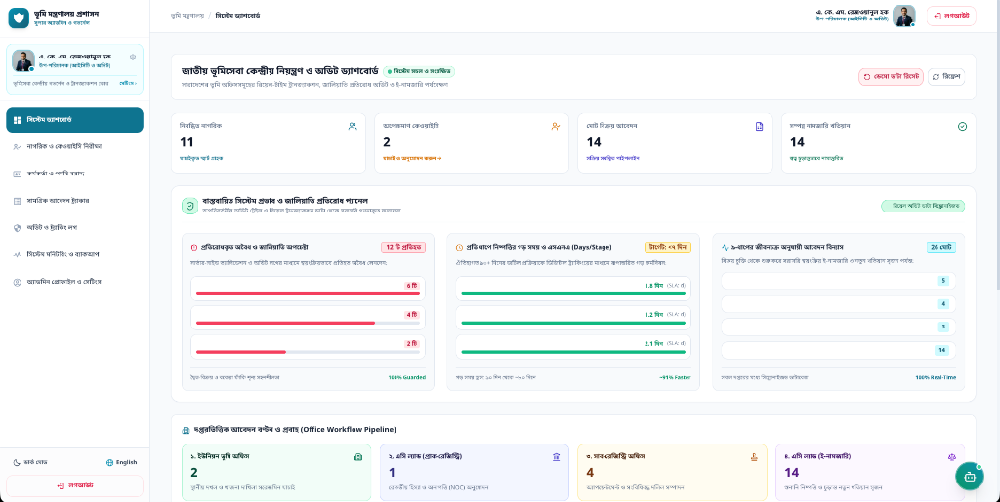
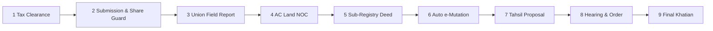
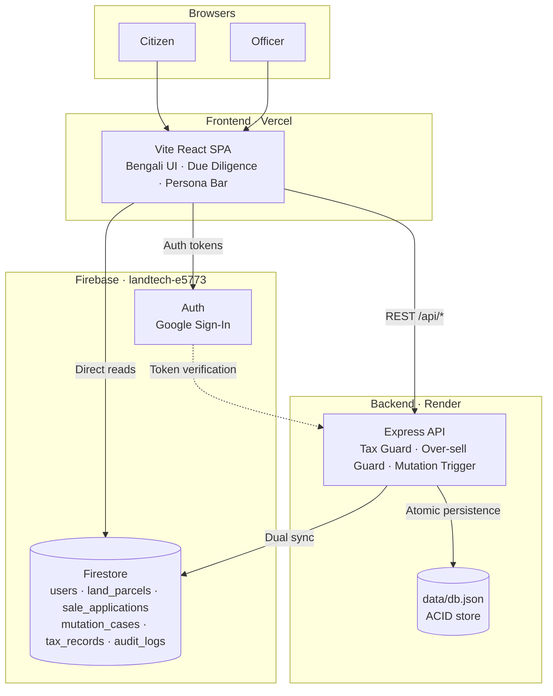

<div align="center">

# 🏛️ VumiSeba (ভূমিসেবা)

### Check before you buy. Register once. Mutate automatically.

**A unified LandTech platform for Bangladesh: pre-purchase due diligence, smart registry, and automated e-Mutation, in one auditable workflow.**

*বাংলাদেশ নাগরিক ভূমি সেবা · স্বত্ব যাচাই · স্মার্ট রেজিস্ট্রি · স্বয়ংক্রিয় ই-নামজারি*


[🌐 Live Demo](https://vumi-seba.vercel.app) · [🎬 Demo Video](https://youtu.be/lvudKKWMx6k) 

<br/>



</div>

---

## 📌 At a Glance

| | |
|---|---|
| **Track** | LandTech Initiative 2026 |
| **What it is** | Full-stack, bilingual (Bengali-first) land services platform with 5 role-based office panels |
| **Core idea** | A risky parcel can never read "Low Risk", and a registered deed automatically becomes a mutation case |
| **Built with** | React 18 · TypeScript · Vite · Express · Firebase · Zod |
| **Quality** | 4 automated test suites, including a full 9-stage lifecycle E2E and 26 Firestore rule assertions |
| **Honesty** | Every simulated integration is labeled in [Real vs Simulated](#-real-vs-simulated) |

---

## 🎯 The Problem

Land disputes are a leading source of civil litigation in Bangladesh. Two structural gaps keep them going:

| Gap | What goes wrong |
|---|---|
| **Pre-purchase blindness** (বায়নার পূর্বে স্বত্ব অন্ধত্ব) | Buyers sign binding earnest-money agreements without knowing if the seller owns the claimed share, whether taxes are overdue, or whether an injunction or mortgage encumbers the plot. |
| **Registry–mutation chasm** (রেজিস্ট্রেশন ও নামজারির ফারাক) | After registering at the Sub-Registry (Ministry of Law), citizens must separately open a mutation case at the AC Land Office (Ministry of Land). The delay lets rogue sellers resell the same plot (*ডাবল-সেল*). |

> 📎 *Add your citation for the litigation statistic here (e.g. Law Commission or court-data source) before submission.*

## 💡 The Solution

**1. 🔍 Check Before You Buy (কেনার আগে জমি যাচাই)**
A transparent 7-factor risk engine with **Critical Factor Overrides**: active injunctions, government khas land, and unrecorded seller shares cap the safety score, so dangerous parcels cannot appear safe regardless of other factors.

**2. ⚡ Smart Registry → Automated e-Mutation (স্বয়ংক্রিয় ই-নামজারি)**
Completing deed registration atomically spawns an e-Mutation case in the AC Land docket. Transferred shares are locked in real time, closing the double-sale window.

---

## ✨ Key Innovations

| Innovation | Why it matters |
|---|---|
| **Critical Factor Overrides** | Business-critical red flags (injunction, khas land, share mismatch) dominate the weighted score. |
| **Basis-Point Share Math** | Shares are stored as integers out of `10,000 BPS`, which eliminates fractional drift across generations of transfers. |
| **Double-Sale Guard + Mutex** | Active reservations lock pending shares; store transactions are serialized. |
| **Downstream Re-Validation** | Tax, injunction, and share validity are re-checked before *every* officer approval, not just at submission. |
| **Registry → Mutation Atomicity** | One action commits the deed and creates the linked mutation case. |
| **Immutable Audit Trail** | Server-side audit log; Firestore rules enforce `allow update, delete: if false`. |
| **Bengali-first UX** | Plain-Bengali legal recommendations, Bengali review notes, bn-BD locale. |

---

## 🎬 3-Minute Demo Path

Run the app, then click the floating **"৩-মিনিট ডেমো গল্প (3-Min Guided Demo Story)"** button. Or follow this manually using the **Demo Persona Bar** (1-click role switching):

| Step | Persona | Action | What to notice |
|:-:|---|---|---|
| 1 | Buyer | Verify land (Dag 405) on `/citizen/verify-land` | Risk score with weighted indicators and Bengali recommendations |
| 2 | Seller (tax due) | Try to submit a sale on Dag 882 | Blocked at the server: ৳4,850 arrears |
| 3 | Seller (over-sell) | Try to sell 80% of a 12.5% share (Dag 102) | Blocked by the share guard |
| 4 | Union Officer | Review and forward Dag 405 | Field findings persisted; re-validation runs |
| 5 | AC Land | Approve pre-registration | Routes to Sub-Registry |
| 6 | Sub-Registrar | Schedule appointment, complete registration | **e-Mutation case auto-spawns** |
| 7 | AC Land | Hold hearing, approve mutation | New Khatian issued, shares recalculated |
| 8 | Admin | Open audit logs | Every step recorded immutably |

---

## 📸 Screenshots

<table>
  <tr>
    <td align="center" width="50%"><b>Citizen Dashboard</b><br/></td>
    <td align="center" width="50%"><b>Union Land Office</b><br/></td>
  </tr>
  <tr>
    <td align="center" width="50%"><b>AC Land Revenue Court</b><br/></td>
    <td align="center" width="50%"><b>Sub-Registry Office</b><br/></td>
  </tr>
  <tr>
    <td align="center" width="50%"><b>Central Admin & Audit</b><br/></td>
    <td></td>
  </tr>
</table>

---

## 🚀 Quick Start

**Prerequisites:** Node.js 20 LTS (18.18+ works) · npm 9+ · Git 2.30+

```bash
git clone https://github.com/BornilMahmud/VumiSeba.git && cd VumiSeba
npm install
npm run seed:demo     # 21 synthetic parcels across 12 districts
npm run dev           # API :5050 · SPA :3000
```

Open **http://localhost:3000**. No configuration needed; `cp .env.example .env` to customize.

<details>
<summary><b>Optional: seed Cloud Firestore</b></summary>

```bash
npm run seed:firestore   # idempotent: demo accounts + parcel records
```
</details>

---

## 🔄 The 9-Stage Lifecycle



| # | Stage | What happens |
|:-:|---|---|
| 1 | Tax Clearance & Dakhila | Arrears block submission server-side until cleared |
| 2 | Submission + BPS Share Guard | Proposed shares locked with integer arithmetic |
| 3 | Union Field Investigation | On-ground possession, boundary, and tenant-rights report |
| 4 | AC Land Title NOC | State re-validated before approval |
| 5 | Sub-Registry Deed | Biometric sign-off commits the deed record |
| 6 | Auto e-Mutation Case | Registry execution atomically creates the case |
| 7 | Tahsil Proposal | Automated routing to the relevant field circle |
| 8 | Hearing & Order | AC Land issues the formal mutation judgment |
| 9 | Final Khatian | Digital Khatian with QR code; seller share decremented |

<details>
<summary><b>Full state machine</b></summary>

```
[Citizen: Submit Application]
        │
        ▼
[1 UNION_REVIEW_PENDING] ──► RETURNED_FOR_CORRECTION (citizen resubmits)
        │                 └─► UNION_REJECTED
        ▼
[2 AC_LAND_REVIEW_PENDING] ─► RETURNED_FOR_CORRECTION
        │                  └─► AC_LAND_REJECTED
        ▼
[3 REGISTRATION_READY]
        ▼
[4 APPOINTMENT_SCHEDULED]     in-app alerts triggered
        ▼
[5 REGISTRATION_COMPLETED]    deed no. / volume recorded
        ▼  (auto-spawn linked e-Mutation case)
[6 MUTATION_PENDING]
        ▼
[7 HEARING_SCHEDULED] ──────► MUTATION_REJECTED
        ▼
[8 MUTATION_APPROVED]         new Khatian & shares updated
        ▼
[9 KHATIAN_DELIVERED]
```
</details>

---

## 🧪 Real vs Simulated

> Operational honesty over inflated claims. Details in [`docs/LIMITATIONS.md`](docs/LIMITATIONS.md).

| Component | Status | Boundary |
|---|:-:|---|
| Risk Engine & Critical Overrides | ✅ Real | 7 factors; injunctions and khas land strictly override scores |
| Share Math (BPS) | ✅ Real | Integer basis points, zero rounding drift |
| Double-Sale Guard & Mutex | ✅ Real | Reservations lock pending shares; transactions serialized |
| Downstream Re-Validation | ✅ Real | Tax, injunction, share validity re-checked at each approval |
| 9-Stage Inter-Office Workflow | ✅ Real | Full RBAC for 5 roles with live dashboards |
| Immutable Audit Log | ✅ Real | Enforced in both API and Firestore rules |
| National NID / Porichoy | 🧪 Simulated | Synthetic NIDs, deterministic validation (real API requires Gov NDA) |
| Sonali e-Challan / Payment | 🧪 Simulated | Real ledger and receipts; simulated gateway callback |
| Judicial Case Registers | 🧪 Simulated | Seeded cases and injunctions across 21 synthetic parcels |

---

## 🏗️ Architecture



> **Data note:** the deployed server persists to the local ACID JSON store. The client ships full Firestore adapters, rules, and indexes; server-side Firestore persistence needs a Firebase Admin service-account key. The built-in store keeps evaluation zero-config and tests reproducible.

---

## 🧰 Tech Stack

| Layer | Technology |
|---|---|
| **Frontend** | React 18 · TypeScript · Vite 6 · React Router v7 |
| **Styling** | Tailwind CSS v3 (`gov-navy` / `gov-teal` / `gov-amber` / `gov-blue` tokens) · shadcn/ui · Lucide |
| **Typography** | Hind Siliguri · Noto Sans Bengali · Inter |
| **Backend** | Node.js 20 · Express 4 · TypeScript (tsx) · Zod |
| **Auth** | Firebase Authentication (Google) + stateless JWT with bcrypt |
| **Data** | Cloud Firestore · persistent ACID JSON store |
| **Hosting** | Vercel (SPA) · Render (API) · Firebase (Auth, Rules, Indexes) |

*UI attribution: animated service gateways use `@skiper-ui/skiper40` (CssLink) by [@gurvinder-singh02](https://x.com/Gur__vi).*

---

## 🏢 Roles & Office Panels

Strict RBAC across five areas, each with its own route namespace, theme, and permitted actions.

| Panel | Role ID | Route prefix | Key actions |
|---|---|---|---|
| 🧑 Citizen | `citizen` | `/citizen/*` | Verify land, pay tax, apply for sale, track mutation |
| 🌿 Union Land Office | `union_officer` | `/office/union/*` | Field inspection; approve / return / reject |
| ⚖️ AC Land Office | `ac_land` | `/office/ac-land/*` | Pre-reg approval; mutation hearings and orders |
| 📜 Sub-Registry | `sub_registrar` | `/office/registry/*` | Schedule appointments; complete registration |
| 🛡️ Central Admin | `central_admin` | `/admin/*` | KYC, role provisioning, audit logs, monitoring |

<details>
<summary><b>Route details per panel</b></summary>

**Citizen** — `dashboard` · `my-land` · `search-land` · `verify-land` · `tax` · `sale-applications` · `my-applications` · `mutation-applications` · `notifications` · `profile`

**Union Officer** — `dashboard` · `applications` · `applications/:id` · `tax-verification` · `record-verification` · `reports` · `history`
Return and reject actions require a Bengali explanation.

**AC Land** — `dashboard` · `applications` · `applications/:id` · `mutation` · `hearings` · `decisions` · `history`
Mutation approval issues Khatian `নামজারি-XXXX` and recalculates shares.

**Sub-Registry** — `dashboard` · `applications` · `applications/:id` · `appointments` · `documents` · `completed` · `history`
Completing registration records deed number, volume, and fees, then auto-spawns the e-Mutation case.

**Central Admin** — `dashboard` · `users` · `roles` · `applications` · `offices` · `monitoring` · `audit-logs` · `demo-data` · `settings`
</details>

---

## 👥 Demo Accounts

Entry points: `/login/citizen` · `/login/office` · `/login/admin`, plus the pinned **Demo Persona Bar**.

| Persona | Email | Role | Scenario |
|---|---|---|---|
| Buyer | `buyer@bhumisathi.gov.bd` | citizen | Verified; receives alerts |
| Seller (clean) | `seller@bhumisathi.gov.bd` | citizen | Dag 405 (50%); tax cleared |
| Seller (tax due) | `latif.taxdue@bhumisathi.gov.bd` | citizen | Dag 882; ৳4,850 arrears → blocked |
| Seller (over-sell) | `nazrul.oversell@bhumisathi.gov.bd` | citizen | Dag 102 (12.5%); 80% sale → blocked |
| Union Officer | `kamal.union@bhumisathi.gov.bd` | union_officer | Reviews Dag 405 |
| AC Land | `tanvir.acland@bhumisathi.gov.bd` | ac_land | Approvals and mutation court |
| Sub-Registrar | `roksana.registry@bhumisathi.gov.bd` | sub_registrar | Appointments and deeds |
| Central Admin | `admin@bhumisathi.gov.bd` | central_admin | KYC, roles, audit |

> Demo-only passwords: `DemoCitizen2026!` (Firebase) · `demo123456` (local). Never reuse outside the demo.

<details>
<summary><b>Pre-seeded scenarios (A–I)</b></summary>

| | ID | Parcel | State |
|:-:|---|---|---|
| A | `sa-clean-demo` | Dag ৪০৫ · বাড্ডা | Submitted, awaiting Union review |
| B | `sa-returned-demo` | Dag ৫০২ · বাড্ডা | Returned with Bengali note; resubmittable |
| C | `sa-union-approved-demo` | Dag ৬০৩ · বাড্ডা | In AC Land queue |
| D | `sa-acland-approved-demo` | Dag ৭০৪ · বাড্ডা | Ready for Sub-Registry scheduling |
| E | `sa-scheduled-demo` | Dag ৩০২ · বাড্ডা | Appointment scheduled; notifications sent |
| F | `sa-registered-demo` | Dag ৮০৫ · বাড্ডা | Deed `৪৫১২/২০২৬`; spawned `MUT-AC-2026-9921` |
| G | `sa-rejected-demo` | Dag ৭১০ · আফতাবনগর | Injunction + mortgage; rejected |
| H | `sa-share-mismatch-demo` | Dag ১০২ · ভাটারা | 80% sale on 12.5% share; flagged |
| I | `sa-taxdue-demo` | Dag ৮৮২ · সাঁতারকুল | ৳4,850 arrears flagged |
</details>

---

## ✅ Testing

```bash
npm test                              # core + risk engine + E2E
npm run test:firebase                 # Auth + Firestore rules (26 assertions)
npx tsc --noEmit && npm run build     # type-check + production build
```

| Suite | Covers | Result |
|---|---|---|
| **Core Correctness** | BPS drift, ID collisions, double-sale guard, injunction blocks, re-validation, production JWT safety, serialized mutex | ✅ 7/7 |
| **Risk Engine** | 7 factor groups + 6 table-driven boundary scenarios | ✅ 7/7 |
| **E2E Acceptance** | Seeding, KYC, search, risk scoring, tax guard, over-sell guard, full 9-stage lifecycle to Khatian `নামজারি-৮৮৯৯` | ✅ 100% |
| **Firebase Rules** | Role-elevation guards, immutable audit logs, public search, index coverage | ✅ 26/26 |
| **Build** | `tsc` + `vite build` | ✅ 0 errors · 113 kB gzip main chunk |

---

## 🔌 API Overview

Base path `/api` · Auth `Authorization: Bearer <JWT>` unless noted.

| Area | Key endpoints |
|---|---|
| **Auth** | `POST /auth/register` · `/login` · `/demo-login` · `/firebase-sync` · `GET /auth/me` · `POST /auth/kyc/submit` · `/kyc/verify` |
| **Land & Risk** | `GET /land/search` · `/land/:id` · `/land/my/holdings` · `POST /risk/evaluate` · `GET /risk/:parcelId` |
| **Tax** | `GET /tax/holding/:parcelId` · `POST /tax/pay` · `GET /tax/my/history` |
| **Sale** | `POST /sale/pre-check` · `/submit` · `/:id/union-review` · `/:id/acland-review` · `/:id/schedule-appointment` · `/:id/complete-registration` · `/:id/resubmit` |
| **e-Mutation** | `GET /mutation` · `/mutation/:id` · `POST /mutation/:id/schedule-hearing` · `/approve` · `/reject` |
| **Officer & Admin** | `GET /officer/{union,acland,registry}/queue` · `/officer/admin/stats` · `/officer/admin/users` · `POST /officer/admin/assign-role` |
| **System** | `GET /notifications` · `GET /audit/logs` (admin) · `GET /health` (public) |

<details>
<summary><b>Example: submit a sale (server-side guards)</b></summary>

```bash
curl -X POST http://localhost:5050/api/sale/submit \
  -H "Authorization: Bearer $TOKEN" -H "Content-Type: application/json" \
  -d '{"parcel_id":"<id>","proposed_share":0.8,"total_consideration_bdt":2500000}'
# → 4xx when tax arrears exist, share exceeds recorded ownership, or an injunction is active
```
</details>

---

## 🗄️ Data Model

<details>
<summary><b>Cloud Firestore collections</b></summary>

- **`users`**: `uid`, `email`, `name_bn`, `nid`, `citizen_id` (`BHM-CIT-XXXXXX`), `role`, `kyc_status`, `created_at`
- **`land_parcels`**: location hierarchy, `khatian_no`, `dag_no`, `land_class`, `total_area_decimal`, `ownerships[]`, `tax_status`, `litigation`, `encumbrance`, `acquisition_status`
- **`sale_applications`**: `parcel_id`, `seller_id`, `buyer_id`, `proposed_share`, `total_consideration_bdt`, `status`
- **`mutation_cases`**: `sale_application_id`, `parcel_id`, `buyer_id`, `status`, `resulting_khatian_no`
- **`audit_logs`**: `action`, `actor_role`, `actor_id`, `details`, `timestamp` (immutable)
</details>

<details>
<summary><b>Repository structure</b></summary>

```
VumiSeba/
├── data/db.json                 # Persistent seeded ACID store
├── scripts/                     # seedFirestore.ts · bootstrapAdmin.ts
├── server/
│   ├── index.ts                 # Express entry, health, CORS
│   ├── db/                      # seed.ts · store.ts (atomic JSON store)
│   ├── middleware/              # auth.ts (JWT + RBAC) · audit.ts
│   ├── routes/                  # auth · land · risk · tax · sale · mutation · officer · notifications · audit
│   └── tests/                   # core-correctness · risk-engine · e2e-workflow · firebase-auth-rules
├── src/
│   ├── context/ · services/ · lib/ · types/
│   ├── components/              # common/ · layout/
│   └── pages/                   # public/ · citizen/ · officer/
├── firebase.json · firestore.rules · firestore.indexes.json
└── render.yaml · vercel.json · vite.config.ts · tailwind.config.js
```
</details>

---

## ⚙️ Configuration & Deployment

<details>
<summary><b>Environment variables</b></summary>

**Frontend (Vercel)**

| Variable | Example |
|---|---|
| `VITE_API_BASE_URL` | `https://vumiseba-backend.onrender.com/api` (empty for local proxy) |
| `VITE_FIREBASE_API_KEY` · `_AUTH_DOMAIN` · `_PROJECT_ID` · `_STORAGE_BUCKET` · `_MESSAGING_SENDER_ID` · `_APP_ID` | from your Firebase console |

**Backend (Render)**

| Variable | Example |
|---|---|
| `PORT` | `10000` |
| `NODE_ENV` | `production` |
| `CORS_ORIGIN` | `https://vumi-seba.vercel.app` |
| `JWT_SECRET` | random 64-char string |
| `FIREBASE_PROJECT_ID` | `landtech-e5773` |
| `SIMULATE_SMS` · `SIMULATE_EMAIL` | `true` |
</details>

<details>
<summary><b>Deploy: Vercel, Render, Firebase</b></summary>

**Frontend → Vercel:** import the repo, framework **Vite**, build `vite build`, output `dist`, set `VITE_*` variables. SPA routing is handled by `vercel.json`.

**Backend → Render:** New Web Service (or Blueprint via `render.yaml`).

| Setting | Value |
|---|---|
| Region | Singapore |
| Build | `npm install && npm run build:server` |
| Start | `node dist-server/server/index.js` |
| Health check | `/api/health` |

**Firebase:**
```bash
npx firebase-tools login
npx firebase-tools deploy --only firestore:rules   --project landtech-e5773
npx firebase-tools deploy --only firestore:indexes --project landtech-e5773
npm run seed:firestore
```
Add your Vercel domain under Authentication → Settings → Authorized domains.
</details>

---

## 🔒 Security & Privacy

- **No self-promotion:** rules and API block role self-elevation; Google Sign-In defaults to `citizen`.
- **Protected admin bootstrap:** admin status only via CLI (`npm run admin:bootstrap`), permanently logged.
- **Immutable audit trail:** `audit_logs` cannot be updated or deleted.
- **PII protection:** NIDs and KYC uploads restricted to the owner and authorized officers.
- **Strict CORS** and **zero committed secrets** (`.gitignore` excludes keys and service accounts).

---

## ⚠️ Known Limitations

- Government integrations (NID, e-Challan, court registers) are **mocked** with realistic schemas.
- Payments use an instant **simulated** gateway.
- Court records and injunctions are **synthetic**.
- This is an MVP prototype; generated drafts carry a disclaimer that they are **not official government documents**.

---


---

## 🤝 Contributing

```bash
git checkout -b feature/your-feature
git commit -m "feat: your change"     # conventional commits
npm test && npm run test:firebase && npm run build
git push origin feature/your-feature  # then open a PR
```

---

## 👤 Team

| Name | Role | GitHub | LinkedIn | 
|:-:|:-:|:-:|:-:|  
| **Arman Hossen** | Frontend | [GitHub](https://github.com/armanhossen-dev) | [LinkedIn](https://www.linkedin.com/in/armanhossenripon) |
| **Bornil Mahmud** | Backend | [GitHub](https://github.com/BornilMahmud) | [LinkedIn](https://www.linkedin.com/in/bornilmahmud/) |

---

<div align="center">

Built for **LandTech Initiative 2026** · Released under the **MIT License**

</div>
