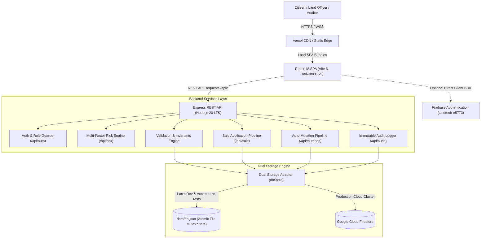
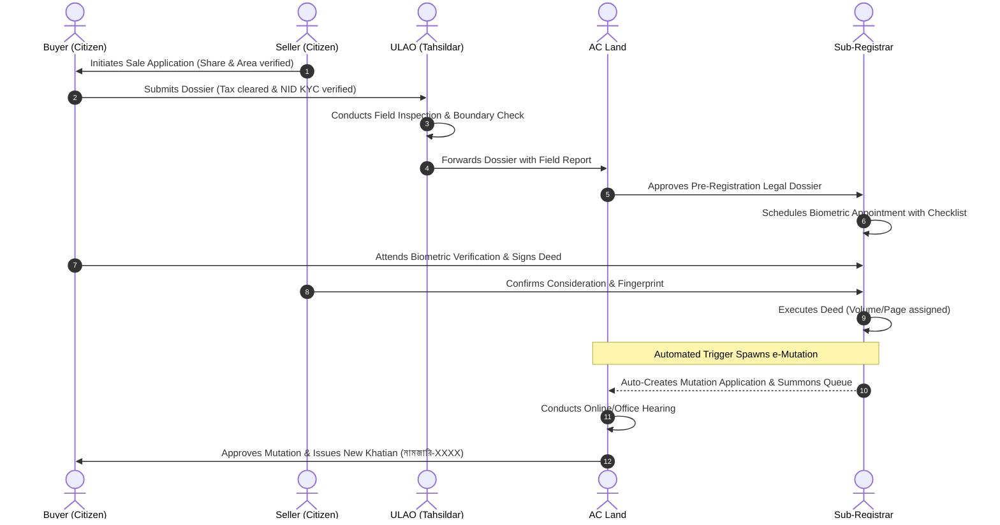

# System Architecture — VumiSeba (ভূমিসেবা)

## 1. High-Level Architecture Overview

**VumiSeba** is constructed as a modern, decoupled full-stack monorepo application. It combines an institutional client-side Single Page Application (SPA) with a high-performance Express REST API and a resilient dual-database layer.

---

## 2. Directory Layout & Module Responsibilities

| Path | Purpose & Responsibility |
|:---|:---|
| `src/` | Client-side source code (React 18, TypeScript, Tailwind CSS). |
| `src/components/common/` | Reusable UI atoms and domain widgets (`ApplicationTimeline`, `DeedDraftModal`, `RiskBadge`, `StatusBadge`, `ChatbotBubble`, `DemoPersonaBar`). |
| `src/components/layout/` | Institutional layouts per role (`CitizenLayout`, `UnionOfficeLayout`, `AcLandOfficeLayout`, `RegistryOfficeLayout`, `AdminOfficeLayout`). |
| `src/context/` | React context providers: `AuthContext.tsx` (session and credentials), `LanguageContext.tsx` (bilingual state). |
| `src/pages/public/` | Public informational and self-service pages (`HomePage`, `SearchLandPage`, `VerifyLandPage`, `HowItWorksPage`, `ServicesPage`, `HelpPage`). |
| `src/pages/citizen/` | Citizen portal (`CitizenDashboard`, `MyLandPage`, `DealsPage`, `MyApplicationsPage`, `ProfileKycPage`). |
| `src/pages/office/` | Institutional role portals (`union/*`, `acland/*`, `registry/*`). |
| `src/pages/admin/` | National admin consoles (`AdminDashboard`, `AdminApplicationsPage`, `AdminUsersPage`, `AdminRolesPage`, `AdminAuditLogsPage`). |
| `server/` | Express backend application written in TypeScript. |
| `server/db/` | Database store interface (`store.ts`) and full deterministic seed script (`seed.ts`). |
| `server/routes/` | REST route handlers (`auth.ts`, `risk.ts`, `sale.ts`, `mutation.ts`, `officer.ts`, `admin.ts`, `audit.ts`, `chat.ts`). |
| `server/services/` | Business validation rules (`validation.service.ts`), risk computation, and sequence generation. |
| `server/tests/` | Automated test suites (`core-correctness.test.ts`, `risk-engine.test.ts`, `e2e-workflow.test.ts`, `firebase-auth-rules.test.ts`). |
| `data/db.json` | Active local database store with seeded test records. |

---

## 3. Dual-Database Architecture

To provide zero-dependency local development, rapid hackathon evaluation, and scalable cloud execution, VumiSeba implements a **Dual-Database Adapter Pattern** in `server/db/store.ts`:

1. **Local Atomic JSON Store (`data/db.json`):**
   - Utilizes an in-process serialized mutex queue for concurrent writes.
   - Employs temporary write-and-rename atomic flushing to protect against corruptions.
   - Allows instant test teardown and deterministic resets via `runSeed()`.
2. **Cloud Firestore Adapter (`landtech-e5773`):**
   - Implements identical collections: `land_parcels`, `profiles`, `sale_applications`, `mutation_applications`, `appointments`, `registration_records`, `audit_logs`.
   - Governed by comprehensive declarative security rules in `firestore.rules`.
   - Optimized with composite queries defined in `firestore.indexes.json`.

---

## 4. Key Cross-Office Data Flow (Problem 4: Smart e-Registry & Auto-Mutation)

